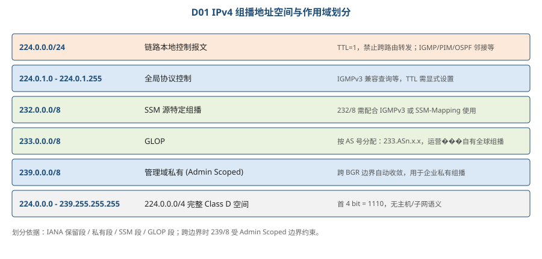
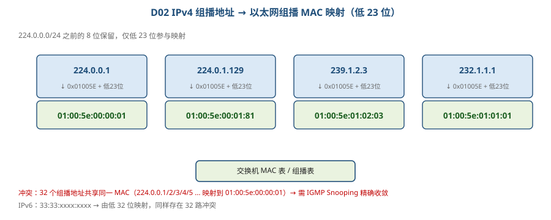
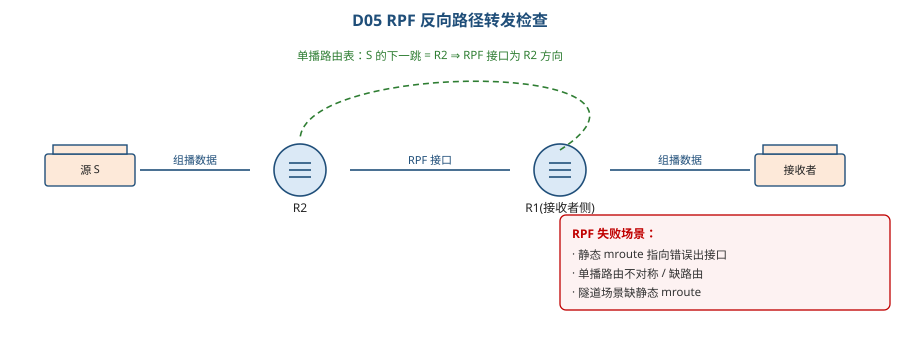
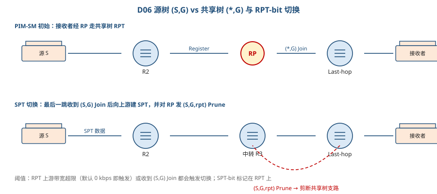

# 第 1 章 组播基础模型、地址体系与分发树

> 精读来源：**Williamson Ch1–Ch2（纸面 p.4–55）**、**Aweya Ch1.1–1.7（纸面 p.1–45）**
> 本章解决的问题：一个组播包凭什么能被"该收到的人收到、不该收到的人收不到"。

## 学习目标

1. 用一句话说清组播与单播/广播/Anycast 的**转发决策差别**（看目的地址 vs 看源地址）；
2. 不查资料写出 IPv4 组播的 5 个特殊段（224.0.0.0/24、224.0.1.0/24、233/8、232/8、239/8）及其行为；
3. 手算任意组播地址的 MAC，并解释 **32:1 歧义**会造成什么现网故障；
4. 画出源树/单向共享树/双向共享树，说明（S,G）与（*,G）状态与适用场景；
5. 解释 RPF 为什么用"源地址 + 单播路由表"，以及 RPF 失败的四类成因；
6. 说清 TTL 阈值与管理边界（239/8）的区别和现网落点。

---

## 1. 四种通信模型：区别只在"转发决策的依据"

Williamson Ch1 用 ACME 网络电台案例给出组播的三个收益（p.8–11）：**带宽**（8 kbps 音频，单播随用户数线性增长，组播恒定）、**服务器负载**（单播每客户端一条流）、**网络负载**（首跳路由器复制，比多流省）。

更要记住三个**固有代价**（p.12–14），它们决定了组播应用必须自带的能力：

| 代价 | 原文要点 | 工程含义 |
|---|---|---|
| **不可靠** | "IP multicast, like IP unicast, is inherently unreliable"，走 UDP，无重传 | 应用层必须容忍丢包（FEC/重传请求/关键帧刷新） |
| **重复包** | 收敛期冗余路径产生副本，"routers intentionally send copies out multiple interfaces" | 应用必须**幂等**。书中记录真实事故：某政府机构用组播下发控制命令未做去重，命令被**执行多次**（p.13 NOTE） |
| **无拥塞控制** | 组播无法用 TCP，"no built-in congestion avoidance mechanism" | 500 kbps 视频误加入 256 kbps 专线直接打死链路（p.14 Figure 1-6），必须限速+边界 |

四种模型的转发依据：

| 模型 | 目的地址 | 转发决策依据 | 谁复制 |
|---|---|---|---|
| 单播 | 单个主机 | **目的**地址查单播 RIB | 沿途每跳各自转发一份 |
| 广播 | 子网广播地址 | 出所有同广播域端口，**路由器不转发** | L2 交换机泛洪 |
| **组播** | D 类组地址 | **源**地址做 RPF + 组播路由表决定出接口 | 分叉点路由器复制 |
| Anycast | 一组主机共享地址 | 目的地址查 RIB，就近一台 | 不复制（本质单播） |

> **一句话**：单播"往哪送"看目的，组播"从哪来"看源——这就是 RPF 的全部由来。

---

## 2. IPv4 组播地址体系（背下来）

D 类格式 `1110xxxx`（原文 p.27），范围 **224.0.0.0 – 239.255.255.255**。真正要背的是**分段行为**：

| 网段 | 名称 | 行为 | 现网用途 |
|---|---|---|---|
| 224.0.0.0/24 | **Link-Local** | **路由器永不转发**，与 TTL 无关（原文："not forwarded by IP routers regardless of their TTL values"，p.27） | 协议保活（IGMP/PIM/OSPF） |
| 224.0.1.0/24 | Internetwork Control | 可转发 | 跨跳协议（NTP、Auto-RP 224.0.1.39/40） |
| 232.0.0.0/8 | **SSM** | 必须 IGMPv3 + 指定源 | 视频分发、行情推送 |
| 233.0.0.0/8 | **GLOP**/静态分配 | 按 ASN 编码，全球唯一 | 跨域会议、内容分发 |
| 233.252.0.0/24 | MCAST-TEST-NET（RFC 5771） | 文档/实验专用 | 写文档、做实验 |
| 239.0.0.0/8 | **Administratively Scoped** | 默认不跨域，需显式边界 | 企业内部一切业务 |

**Williamson Table 2-1 原文（link-local 段，p.27–28）**——排障字典，看到 224.0.0.x 就知道是谁：

| 地址 | 用途 | 地址 | 用途 |
|---|---|---|---|
| 224.0.0.1 | All Hosts（IGMP 查询目标） | 224.0.0.9 | RIP2 Routers |
| 224.0.0.2 | **All Multicast Routers** | 224.0.0.10 | IGRP Routers |
| 224.0.0.4 | DVMRP Routers | 224.0.0.12 | DHCP Server/Relay |
| 224.0.0.5 | OSPF All Routers | 224.0.0.13 | **All PIM Routers**（PIM Hello） |
| 224.0.0.6 | OSPF DR | 224.0.0.15 | All CBT Routers |
| 224.0.0.7 / .8 | ST Routers / Hosts | 224.0.0.18 | VRRP |

Table 2-2（p.28–29）高频项：**224.0.1.39 Cisco-RP-Announce / 224.0.1.40 Cisco-RP-Discovery**（Auto-RP）、**224.0.1.32 Mtrace**。

### 2.1 GLOP：用 ASN 自己算

`233.<X>.<Y>.<host>`，X.Y 为 16 位 ASN 的两个字节：

```
ASN 65001 = 0xFD E9 → 233.253.233.0/24
ASN 64512 = 0xFC 00 → 233.252.0.0/24   ← 与 MCAST-TEST-NET 冲突，禁用
```

### 2.2 SSM 段（232/8）的两个硬约束

- 路由器侧 `ip pim ssm default`（或指定 range），接口跑 **IGMPv3**；
- 应用侧 API 必须"带源加入"（`IP_ADD_SOURCE_MEMBERSHIP`）。

只做地址规划、不做这两件事 = "配了 SSM 但收不到"（案例 1-3）。

### 2.3 IPv6 对照（Aweya 1.4.5）

`FF00::/8`，格式 `FF<flags><scope>:...`：

| scope | 含义 | 对应 IPv4 |
|---|---|---|
| 2 | Link-Local | 224.0.0.0/24 |
| 5 | Site-Local | 239/8（类似） |
| 8 | Organization-Local | — |
| E | Global | GLOP/公网 |

常用：`FF02::1` 全节点、`FF02::2` 全路由器、`FF02::5/6` OSPFv3、`FF02::D` PIM、`FF02::16` MLDv2 报告、`FF3x::/32` SSM。

---

## 3. 二层映射：为什么只有 23 位

### 3.1 算法

取组播地址**低 23 位**，前拼 `01:00:5E`：

```
239.255.0.1
  1110 1111 . 1111 1111 . 0000 0000 . 0000 0001
  取低 23 位：      0 1111 1111 . 0000 0000 . 0000 0001
→ 01:00:5E:7F:00:01     （原文 p.30 Figure 2-3 实例）
```

实用公式：

```text
MAC = 01:00:5E:(IP[1] & 0x7F):IP[2]:IP[3]
232.1.1.1 → 01:00:5E:01:01:01
224.1.1.1 → 01:00:5E:01:01:01   ← 完全相同
```

### 3.2 32:1 歧义

丢 5 位 = **32 倍**（原文："this results in 2^5 or 32:1 address ambiguity"，p.31）。所以 **`224.1.1.1`、`232.1.1.1` 等 32 个组播地址共用同一个 MAC**。

后果链：网卡按 MAC 过滤 → CPU 收到不属于自己的组播 → IP 层再滤一次（耗 CPU）→ 若交换机 ACL/流表按 MAC 下发，会把别的组一起放进来（占带宽，案例 1-2）。

> **为什么当年不一对一映射？** 书中 p.31 "Just 23 Bits?" 记录：Steve Deering 想买 16 个连续 OUI（28 位）做一一映射，但一个 OUI 要 1000 美元，他的经理 Jon Postel 无法批这 16000 美元预算，只买了 1 个 OUI、给了半个（23 位）。**今天的 32:1 麻烦，源于当年省下的 15000 美元。**

### 3.3 IPv6 → MAC

用 `33:33` + 地址**低 32 位**，128 位压到 32 位，歧义更大，但 IPv6 靠 MLDv2 源过滤在 L3 收敛。

---

## 4. 分发树

| 类型 | 状态 | 路径 | 优点 | 缺点 |
|---|---|---|---|---|
| **源树 SPT** | （S,G） | 源到每个接收者最短路 | 时延最优 | 状态数 = 源×组 |
| **单向共享树 RPT** | （*,G） | 源→RP→接收者 | 状态少（每组一棵） | 路径次优，RP 是瓶颈/单点 |
| **双向共享树** | （*,G）双向 | 数据沿树双向流动，**无需源注册** | 无 SPT 切换、无源注册 | 仅 ASM，不能切 SPT |

Williamson 的关键论断（p.34–40）：源树条目数 = 源数 × 组数，共享树只有组数——这就是 PIM-SM 先 RPT、再按需切 SPT 的原因（第 5 章展开）。

---

## 5. RPF：组播的"方向盘"

每收到一个组播包，三步：

1. 查**源地址**的单播路由 → 得到 RPF 接口；
2. 包从 RPF 接口进来 → 通过；否则 **丢弃**（防环）；
3. 通过后查 mroute，按 OIF 列表复制转发。

四类 RPF 失败（第 3 章细讲）：

| 类型 | 现象 | 典型根因 |
|---|---|---|
| 路由不对称 | 组播能到、单播回程走另路 | 双出口、策略路由、主备 |
| 隧道 | 组播进得来、RPF 指向物理口 | GRE/IPsec 隧道、MVPN |
| 缺省路由 | 源在 `0.0.0.0/0` 后面 | 缺 `ip mroute` |
| 等价多路径 | 时通时不通 | ECMP 把 (S,G) 打散 |

原文要点（W p.41–42）：RPF 用的是**单播路由表**而非组播表；mroute 的出接口列表与 RPF 接口相互独立——"mroute 的 in 接口错了"与"单播路由变了"是两类完全不同的故障。

---

## 6. TTL 阈值与管理边界：两种"圈"

| 手段 | 机制 | 粒度 | 失效场景 |
|---|---|---|---|
| **TTL 阈值** | 接口/组设 `threshold`，TTL 小于阈值不转发 | 跳数 | 全域一刀切，无法按业务区分（已基本淘汰） |
| **管理边界**（239/8） | 边界接口 `ip multicast boundary <acl>` | 地址段 | 忘配 = 泄漏到邻居/运营商（案例 1-4） |

二者互补：TTL 管"跑多远"，边界管"往哪跑"。现网主流 = **地址规划 + 边界**；TTL 阈值只在老网遗留。

---

## 7. 组播路由协议分类（选型起点）

| 类别 | 代表 | 建树方式 | 适用 |
|---|---|---|---|
| 密集模式（推） | DVMRP、PIM-DM、MOSPF | 先泛洪再剪枝 | 成员密集、带宽充裕（几乎绝迹） |
| 稀疏模式（拉） | PIM-SM、BIDIR-PIM、CBT | 显式 Join 上行 | 成员稀疏、跨广域（现网默认） |
| 链路状态 | MOSPF | 用 LSDB 算树 | 已淘汰 |

---

## 8. 拓扑图



**图 1-1 地址空间分区**：四个象限对应 224.0.0/24、224.0.1/24、232/8、239/8 的行为差异；左上是"路由器永不转发"的禁区。



**图 1-2 23 位映射**：红色为丢弃的 5 位，它决定了 32:1 歧义；右侧列出同一 MAC 背后的 32 个组地址。



**图 1-3 RPF 检查**：S 经 R1-R2-R3 到接收者；R3 的 RPF 接口必须朝 R2。若单播路由改走 R4，组播被静默丢弃。



**图 1-4 三种分发树**：（S,G）源树最短但状态多；（*,G）共享树状态少但要绕 RP；双向树省掉源注册。

---

## 9. 工程案例（8 例）

### 案例 1-1：30 个分支只有 12 个能收到行情组播

**现象**：总部推 `239.1.1.10:8000`，18 个分支收不到；分支能 ping 通服务器，`show ip mroute` 在分支为空。

**定位**
```cisco
show ip igmp groups 239.1.1.10     ! 无表项 → 主机 Join 没到路由器
show ip pim neighbor               ! 邻居在，但 mroute 无 (*,G)
show ip rpf 10.1.1.100             ! RPF 正常
```
结论：**Join 没上行**。上游 PE 侧抓包发现 PIM Join 全被丢弃。

**根因**：运营商 MPLS VPN 新增安全基线 `deny pim any any`（把 PIM 当高危协议），协议号 103 被拦。

**处置**：CE-PE 接口放行 PIM(103)/IGMP(2)，恢复 `ip pim sparse-mode`，5 分钟内全部恢复。

**复盘**：组播排障第一步永远查"**Join 有没有走通**"（有没有（*,G）、Incoming interface 是否为 Null），而不是查源有没有发。

### 案例 1-2：开了 IGMP Snooping，带宽仍被别的组播占满

**现象**：园区只允许 `239.10.0.1` 会议，但上联口丢包 3%；抓包有 `239.138.0.1` 监控流在泛洪，Snooping 显示"正常"。

**定位**
```cisco
show ip igmp snooping groups vlan 100
show mac address-table multicast vlan 100   ! 两组 MAC 同为 0100.5e0a.0001
```
`239.10.0.1` 与 `239.138.0.1`：`10 & 0x7F = 0x0A`、`138 & 0x7F = 0x0A`，后两字节同为 `0.1` → **MAC 完全相同**，交换机只能按 MAC 下发，无法区分。

**根因**：地址规划只按业务序号分配，未做 **MAC 去重校验**。

**处置**：把 `239.138.0.1` 改为 `239.10.0.11`；规划表增加一列 `IP[1]&0x7F`，同 MAC 的组禁止同 VLAN 共存。

**复盘**：组播地址必须**双重唯一**——IP 唯一 + 低 23 位唯一。千组以内，用 `IP[1]&0x7F` 做分组维度即可规避。

### 案例 1-3：迁到 SSM（232 段）后全部收不到

**现象**：为去掉 RP 依赖，把行情组从 `239.5.5.5` 迁到 `232.5.5.5`，终端"加入成功但无数据"。

**定位**
```cisco
show ip igmp groups 232.5.5.5     ! IGMPv2，无 Source 字段
show ip igmp interface Gi0/1      ! V2  ← 关键
show run | include pim ssm        ! 空
```
**根因**：SSM 三条件全没满足——接口是 IGMPv2、全局无 `ip pim ssm default`、终端用 `IP_ADD_MEMBERSHIP` 而非带源加入。路由器把 232/8 当 ASM，向 RP 注册，RP 上根本没这条流。

**处置**
```cisco
ip pim ssm default
interface Gi0/1
 ip igmp version 3
```
交换机侧确认 `ip igmp snooping v3`；终端 API 改 `IP_ADD_SOURCE_MEMBERSHIP`。

**复盘**：SSM 是**终端 API + 路由器配置 + 交换机版本**三端协同，少一端就是"看着成功、实际不通"。迁移前先抽样统计 IGMPv3 覆盖率。

### 案例 1-4：239 段流泄漏到运营商，被投诉组播风暴

**现象**：运营商通知"CHE 侧收到你们 239.1.0.0 段组播，占满专线"，企业内部一切正常。

**定位**
```cisco
show ip mroute 239.0.0.0 255.0.0.0        ! 看是否有朝 WAN 的 OIF
show run interface Gi0/0/1 | include boundary   ! 空
```
**根因**：PE-CE 口没配 `ip multicast boundary`，239/8 的（*,G）顺着 Join 建到了运营商侧；对端恰好也有人加入同组，形成跨域拉流。

**处置**
```cisco
ip access-list standard MCAST-BOUNDARY
 permit 239.0.0.0 0.255.255.255
interface Gi0/0/1
 ip multicast boundary MCAST-BOUNDARY
```
（ACL 语义是"允许通过"，别写反。）运营商侧同步加边界。

**复盘**：边界是**双向**的——出方向防泄漏、入方向防劫持。开局验收必查：WAN 口 `show ip mroute 239.0.0.0/8` 无条目。

### 案例 1-5：核心有（S,G），汇聚只有（*,G），视频花屏

**现象**：核心 mroute 正常，汇聚侧 `(S,G)` 不存在，视频花屏。

**定位**
```cisco
show ip mroute 239.1.1.10
! (10.1.1.100, 239.1.1.10), flags: P   ← 只有 *,G，SPT 位未置
show ip rpf 10.1.1.100                 ! 指向核心，正常
show ip route 10.1.1.100               ! 两条等价路径
```
**根因**：汇聚-核心 **ECMP**，`(S,G)` 的 RPF 邻居在两条链路间抖动，反复触发 SPT 切换后停留在（*,G），且上游 OIF 与 RPF 不一致导致丢包。

**处置**：为源 /32 加稳定路由；临时 `ip pim spt-threshold infinity` 压住切换；长期把组播流量与单播 ECMP 分离（独立子接口/VLAN）。

**复盘**：**ECMP 是组播的隐性杀手**。设计口诀：组播路径不开 ECMP，或保证 (S,G) 的 RPF 稳定。

### 案例 1-6：主备切换后组播断了 8 分钟

**现象**：WAN 主链路故障切备链，单播 3 秒恢复，组播 8 分钟才恢复。

**定位**
```cisco
show ip rpf 10.1.1.100           ! 已切备链路
show ip mroute 239.1.1.10        ! Incoming interface 仍是旧接口
show ip pim topology 239.1.1.10  ! MRIB 与 MFIB 不同步
```
**根因**：单播已收敛，但组播表 RPF 重校验未及时触发（等 PIM Join 刷新周期）；备链路 MTU 小 40 字节，大包被丢，表现为"通了又断"。

**处置**：启用 RPF 快速重校验/让组播跟随稳定 IGP 拓扑；统一 MTU（`ip mtu` 与物理一致）；验收时测"切换中断时长"。

**复盘**：**组播收敛 ≠ 单播收敛**。验收标准：组播中断 ≤ 3×IGP 收敛 + 2×PIM Hello 周期。

### 案例 1-7：GLOP 地址与别家撞车，出现串流

**现象**：跨运营商内容分发某路流突然收到两个源画面。

**定位**：`show ip mroute 233.10.20.1` 同时有两个（S,G）active，源分属两家。

**根因**：两家都用 `233.10.20.0/24`——一家按 ASN 算错、一家手工指定，GLOP 唯一性被破坏。

**处置**：按 ASN 重算 `233.((ASN>>8)&0xFF).(ASN&0xFF).0/24` 并改配置；CDN 侧加源过滤。

**复盘**：GLOP 只在"严格按 ASN 计算"时唯一；任何手工指定必须登记在册。

### 案例 1-8：测试环境压测打死生产同组业务

**现象**：测试环境压测 `239.1.1.10`（100 Mbps），生产同组业务花屏。

**定位**
```cisco
show ip mroute 239.1.1.10     ! 两个源同时 active：10.1.1.100 与 10.9.9.100
```
**根因**：测试与生产共用同一 L3 组播域且同组地址，接收者收到两路流（不同源、同一组）。

**处置**：测试环境改用 `233.252.0.0/24`（MCAST-TEST-NET）；生产/测试之间加 `ip multicast boundary` 与独立 VRF。

**复盘**：组播地址规划必须区分**环境维度**（生产/测试/演练），否则同组多源是最难查的故障之一。

---

## 10. 自测清单

1. 组播转发为什么看源地址而不看目的地址？若反过来会怎样？
2. `224.0.0.5` 与 `224.0.1.39` 的转发行为有何本质区别？为什么前者永远不会跨路由器？
3. 写出 `239.20.30.40` 对应的 MAC；再写出与它**冲突**的任意一个组播地址。
4. 为什么 SSM 必须搭配 IGMPv3？只有 IGMPv2 时会发生什么？
5. （S,G）状态数量与（*,G）状态数量的关系式是什么？这如何解释 PIM-SM 的 SPT 切换设计？
6. RPF 检查用的是哪张表？如果某条（S,G）的 Incoming interface 与 RPF 接口不一致，包会怎样？
7. 静态 mroute 使用的三个场景，各举一例。
8. TTL 阈值与管理边界的适用差别？为什么现网淘汰了 TTL 阈值？
9. GLOP 地址如何由 ASN 计算？什么情况下它会失效？
10. 一个组播流"终端收到了但内容不对（串流/串画面）"，你会先查哪三层？

---

## 11. 原文精读索引

> 页码为**纸面页码**（Williamson、Aweya 均为 PDF 页 − 21）。本章实际精读页段：**W p.4–41（Ch1 全章 + Ch2 前半）、Aweya p.25–32**，其余小节按目录定位抽取核对。
>
> ⚠️ 早期条目按 PDF 页 − 22 估算，个别页码可能相差 1 页，以“原文可核对要点”为准。

| 知识点 | 书/节 | 纸面页 | 原文可核对要点 |
|---|---|---|---|
| 组播三大收益 | W Ch1 | p.8–11 | 带宽/服务器负载/网络负载；Figure 1-3–1-5 曲线 |
| 三大固有代价 | W Ch1 | p.12–14 | 不可靠、重复包（控制命令被执行多次的真实事故）、无拥塞控制 |
| D 类地址格式 | W Ch2 | p.27 | `1110xxxx …` |
| Link-Local 表 | W Ch2 Table 2-1 | p.27–28 | 224.0.0.1/2/4/5/6/9/10/12/13/15/18 |
| 其他保留地址 | W Ch2 Table 2-2 | p.28–29 | 224.0.1.32 Mtrace、.39/.40 Auto-RP |
| 管理域 239/8 | W Ch2 | p.29 | 类比 RFC1918，需显式配置边界 |
| MAC 映射 | W Ch2 | p.30 | 239.255.0.1 → 01-00-5e-7f-00-01（Figure 2-3） |
| 为何只有 23 位 | W Ch2 | p.31 | "Just 23 Bits?"：16 个 OUI 需 1.6 万美元未获批 |
| 32:1 歧义 | W Ch2 | p.31–32 | MAC 被 32 个组共用、CPU 中断放大 |
| 分发树三类 | W Ch2 | p.34–40 | 源树/单向共享树/双向共享树 |
| RPF 机制 | W Ch2 | p.40–43 | RPF 用单播 RIB、静态 mroute、RPF 接口周期校验 |
| TTL 与管理边界 | W Ch2 | p.43–47 | 阈值 vs 239/8 边界 |
| MAC 映射细节与 OUI | Aweya 1.4.2 | p.25–27 | I/G 位、U/L 位、0x01-00-5E 前缀 |
| 32:1 的教材表述 | Aweya 1.4.3–1.4.4 | p.27–30 | 24 位前缀 → 丢 8 位 → MAC 冲突 |
| IPv6→MAC | Aweya 1.4.5 | p.32 | 33:33 + 低 32 位 |
| RPF 与静态路由 | Aweya 1.6 | p.39–45 | RPF 接口类型、周期性校验 |

---

## 12. 延伸

- 下一章：IGMP 与二层组播（成员如何被"数出来"）
- 相关原文：W Ch3（IGMP，p.56–77）、Aweya Ch2（p.65–127）、iPexpert Ch2
- 标准：RFC 1112（主机扩展）、RFC 3171（IANA IPv4 组播）、RFC 4607（SSM）、RFC 5771（地址分配指南）
