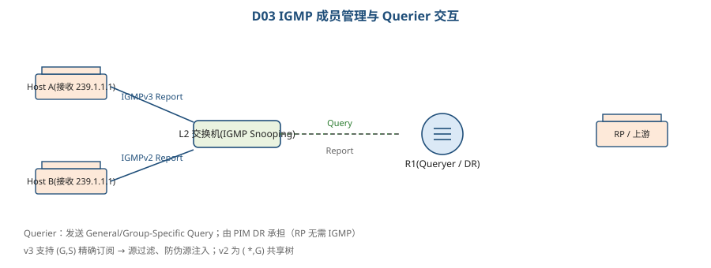
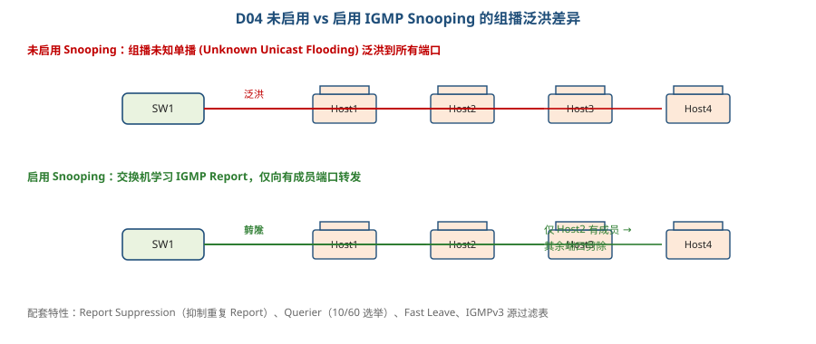

# 第 2 章 IGMP 与二层组播

> 精读来源：**Williamson Ch3（纸面 p.56–77，IGMPv1/v2 全文）**、**Williamson Ch14（p.408–443，Snooping/CGMP）**、**Aweya Ch2**、**iPexpert Ch2**
> 本章解决的问题：接收者如何被"数出来"，以及这个"数"如何在二层不被放大成泛洪。

## 学习目标

1. 背出 IGMPv1/v2/v3 的报文类型与字段差异（尤其 Max Resp Time 的编码与单位）；
2. 背出 6 个关键定时器（125/10/1/260/255/400 秒）并说明各自决定什么现象；
3. 说清 Querier 选举规则，以及"两台 Querier 并存"的后果；
4. 解释报告抑制为什么让"按 IGMP 数成员"永远不准；
5. 说清 IGMPv1 主机在场时为什么**必须忽略 Leave**（原文规则）；
6. 讲清 IGMPv3 的 INCLUDE/EXCLUDE 语义与 SSM 的关系；
7. 掌握 Snooping/Proxy/CGMP/MVR 的取舍与 Fast Leave 的适用边界。

---

## 1. 三个版本：报文与语义

### 1.1 IGMPv1（RFC 1112）

| 类型值 | 报文 | 说明 |
|---|---|---|
| 0x11 | Membership Query | Querier 周期发出，目的 `224.0.0.1`，TTL=1 |
| 0x12 | Membership Report | 目的=组地址，TTL=1 |

**没有 Leave**：主机离开静默，路由器只能等超时——原文给出的最坏值是 **3 分钟**（W p.69："worst-case leave latency of 3 minutes"）。Querier 由 PIM DR/IGP 兼任，IGMPv1 本身无选举。

### 1.2 IGMPv2（RFC 2236）

| 类型值 | 报文 | 目的地址 |
|---|---|---|
| 0x11 | Query（General / Group-Specific） | 224.0.0.1 |
| 0x16 | V2 Membership Report | 组地址 |
| 0x17 | **Leave Group** | **224.0.0.2**（All Routers） |
| 0x12 | V1 Membership Report（兼容） | 组地址 |

关键字段 **Max Resp Time（第 2 字节，单位 0.1 s）**：IGMPv1 查询该字段为 0，v2 主机按 **100 = 10 秒**解释——版本识别就看这一字节（W p.74）。

### 1.3 IGMPv3（RFC 3376）

- 报告 0x22，携带**源列表**与过滤模式 INCLUDE/EXCLUDE；
- 六种记录：`IS_IN`(1) `IS_EX`(2) `TO_IN`(3) `TO_EX`(4) `ALLOW`(5) `BLOCK`(6)；
- 查询 0x11，额外支持"组+源"特定查询。

原文对 v3 的动机很工程化（W p.76）：音频会议里有人恶意 jam（放音乐/说话），用户只能本地 mute，**流量照样占满本子网链路**；v3 让主机对（S,G）做加入/离开，从网络上掐掉不要的源。

| 场景 | 主机记录 |
|---|---|
| 加入 SSM 源 | `ALLOW(S,G)` / `IS_IN(S,G)` |
| 屏蔽某源（ASM） | `BLOCK(S,G)` / `IS_EX` |
| 不关心源 | `IS_IN` 空源列表（等价 v2 Join） |

---

## 2. 六个数字（排障全靠它们）

| 参数 | 默认值 | 决定什么 | 调整后果 |
|---|---|---|---|
| **Query Interval** | **125 s** | 通用查询周期 | 调小→报文多、CPU 高；调大→收敛慢 |
| **Max Response Time** | **10 s**（编码 100） | 主机应答窗口 | 调大→应答分散抗突发，但**离网延迟变大**（W p.68 明确点出 trade-off） |
| Group-Specific Max Resp | **1 s** | Leave 后确认窗口 | 决定 Fast Leave 等待时长 |
| **Group Membership Interval** | **260 s**（2×125+10） | 无应答后删组 | 调小→抖动掉组；调大→僵尸组 |
| **Other Querier Present** | **255 s**（2×125+5） | 备 Querier 判定 | 决定双 Querier 收敛 |
| **V1 Router Present** | **400 s** | v2 主机降级 v1 | 混跑兼容期 |

> 记忆链：**125 → 260（×2+10）→ 255（×2+5）→ 400**。背住这四个数，`show ip igmp groups` 里 `Uptime/Expires` 的异常一眼能看出来。

---

## 3. Querier 选举

| 版本 | 规则 |
|---|---|
| IGMPv1 | 无选举，由 **PIM DR / IGP** 决定 |
| IGMPv2 | **IP 最低者**当选（听到更低地址的 Query 就让位） |
| IGMPv3 | 同 v2 |

**双 Querier 并存**的后果：主机收到两份 Query、应答窗口被压缩、报告风暴；Snooping 表在两台设备上不一致。典型成因：二层把两个 VLAN 打通，或两台三层设备 Subnet 重叠。

---

## 4. 报告抑制：省了带宽，废了统计

机制：主机收到**同组**其他 Report 后取消自己待发的 Report。原文（W p.61）承认它减少 IGMP 流量，但 NOTE 明确提醒 **"routers cannot keep track of the individual hosts"**。

工程后果：

1. 任何"按 IGMP 数成员"的方案都不准（运营商做频道热度统计常踩）；
2. 与 Snooping 交互时，依赖"看到 Report 才建表"的实现会漏建端口（案例 2-1）；
3. **IGMPv2 Report 不触发 v1 主机抑制**（v1 看不懂 v2 报文，W p.75），混跑时同时出现 v1/v2 两份 Report，属正常。

**v1 主机在场规则（必记）**：v2 路由器为该组设置 **V1 Host Present 定时器（= Group Membership Interval）**，期间**忽略该组 Leave**。原因（W p.75）：v1 主机不理解 Group-Specific Query，若最后一个成员是 v1 主机，路由器查询无人应答会**错误超时删组**。

---

## 5. 二层：把"该发的口"找出来

### 5.1 问题本质

组播 MAC `01:00:5E:xx:xx:xx` 默认被交换机当未知单播/广播 → VLAN 内泛洪。10 路 4 Mbps 视频 = 40 Mbps 打到每个接入端口。

### 5.2 四种收敛手段

| 手段 | 原理 | 优点 | 代价 |
|---|---|---|---|
| **IGMP Snooping** | 偷听 Query/Report，建 `(VLAN,组) → 端口` 表 | 标准、跨厂商 | 需处理路由器端口；未知组仍泛洪；大表耗内存 |
| **IGMP Proxy** | 交换机代主机向上游发 Report，向下游代理 Query | 减少上游 IGMP 报文 | 半透明，依赖厂商实现 |
| **CGMP**（Cisco 私有） | 路由器把 `(组,MAC,端口)` 告知交换机 | 交换机零解析、CPU 省 | 仅 Cisco，需路由器参与 |
| **MVR** | 独立组播 VLAN 跨 VLAN 复制 | 运营商 IPTV 单 VLAN 承载 | 配置复杂 |

### 5.3 Snooping 的四个关键行为

1. **路由器端口（mrouter port）**：从该口收到 IGMP Query 或 PIM Hello（`224.0.0.13`）→ 标记为 mrouter，所有组的 Report/数据往上送；
2. **未知组泛洪**：没表项的组仍泛洪，所以"先有流量后建表"必然有一小段泛洪；
3. **Fast Leave**：收到 Leave 立即删端口，不发 Group-Specific Query。**只在单端口单主机时安全**（案例 2-3）；
4. **v3 需显式支持**：部分平台要 `ip igmp snooping v3`，否则 v3 报告被丢弃，SSM 不通。

---

## 6. 拓扑图



**图 2-1 IGMP 交互时序**：Query（125 s 周期、目的 224.0.0.1）→ 随机 0–10 s 内 Report → Leave 发往 224.0.0.2 → Group-Specific Query（Max Resp 默认 1 s）→ 无人应答才删组。注意图中两条 Report 只有一条真正发出（报告抑制）。



**图 2-2 Snooping 前后对比**：左侧未开 Snooping，视频流从所有接入口泛洪；右侧建立 `(VLAN,组)→端口` 表后只走成员口，mrouter 口（朝三层）始终保留。

---

## 7. 工程案例（8 例）

### 案例 2-1：Snooping 开了，20 台终端里总有 3–5 台花屏

**现象**：某会议室 20 个终端看同一路 `239.10.0.5`，每次开会总有 3–5 台花屏，随机轮换；重连有时能好。

**定位**
```cisco
show ip igmp snooping groups vlan 100      ! 239.10.0.5 只列出 15–17 个端口
show ip igmp snooping querier vlan 100     ! Querier 存在，正常
debug ip igmp snooping events              ! 漏建的端口从未出现 report 事件
```
**根因**：**报告抑制**——20 台终端同时收到上层 Query，只有最快的一台发 Report，其余取消；而该交换机 Snooping 是"看到 Report 才建表"的实现，慢启动/后接入的端口在下一轮 Query 前没有表项，数据不到。

**处置**：① 接口开 `ip igmp snooping fast-leave` 并让接入层立即响应；② 更根本的是把 Snooping 改为"Unknown 组泛洪 + 立即建表"（多数平台默认 `flood unknown`）；③ 对会议终端启用 **IGMPv3**，v3 报告不做抑制（RFC 3376 明确取消抑制以支持源过滤）。

**复盘**：**报告抑制是二层组播最隐蔽的坑**。凡是"随机少数终端收不到、且能自愈"的现象，先怀疑它。

### 案例 2-2：开了 Fast Leave，一个端口下两台电视只剩一台能看

**现象**：客房楼层每个端口下挂一台小交换机（客厅电视 + 卧室电视），开启 `fast-leave` 后，关掉客厅电视，卧室电视同时黑屏，重新换台即恢复。

**定位**
```cisco
show ip igmp snooping groups vlan 200      ! 关掉一台后该端口立即消失
show ip igmp snooping                     ! fast-leave 已启用
```
**根因**：Fast Leave 收到 Leave 就**立即删端口**，不再发 Group-Specific Query；同端口下第二台主机没有机会"喊一声我还在"。

**处置**：在"端口下可能多主机"的场景（客房、教室、下挂小交换机/AP），关闭 fast-leave 或改用 `fast-leave` 的**按端口白名单**；或启用 **IGMP Proxy + 逐主机代理**。

**复盘**：Fast Leave 的前提是**一个端口一个订阅者**。凡是"端口下挂交换机/AP/软 AP"的场景，一律不用 Fast Leave。

### 案例 2-3：两个三层口配在同一 VLAN，组表每 4 分钟闪断一次

**现象**：组播每约 4 分钟断 3–5 秒后自愈，`show ip igmp groups` 里组表周期性消失重建；两台三层设备 CPU 均有尖峰。

**定位**
```cisco
! 两台三层设备
show ip igmp interface vlan 100     ! 两台都是 Querier
show ip igmp groups                 ! 两台都有表项，且 Expires 周期性归零
```
抓包可见 VLAN 100 内**两份 Query**（间隔 125 s，来自两个不同源 IP）。

**根因**：两台三层设备 Subnet 重叠在同一 VLAN（原本想做成网关冗余），IGMPv2 按"IP 最低者当选"本应只有一台发 Query，但其中一台配了 `ip igmp version 1`（走 PIM DR 逻辑），两套选举规则并存 → **双 Querier**，主机应答被切分，某轮无人应答即超时删组。

**处置**：统一 IGMP 版本（都 v2/v3），并在非 Querier 设备上 `no ip igmp querier`（部分平台为 `ip igmp version` 一致后自动让位）；网关冗余改用 HSRP/VRRP 的**同一虚拟 IP** 承担 Querier。

**复盘**：网关冗余 ≠ 两个 Querier。设计时明确"谁是 Querier"，并把它写成验收项。

### 案例 2-4：Snooping 表里没有 mrouter 口，整 VLAN 收不到

**现象**：单播正常，整个 VLAN 所有终端都收不到组播；`show ip igmp snooping groups` 有成员端口，但没有朝网关的口。

**定位**
```cisco
show ip igmp snooping mrouter vlan 100      ! 空
show ip igmp snooping groups vlan 100       ! 只有 access 端口
! 上游三层
show ip igmp interface vlan 100             ! IGMP 未 enable 或 Query 被 ACL 拦
```
**根因**：Snooping 靠**听到 Query 或 PIM Hello** 来标记 mrouter 口。该环境三层侧把 IGMP（协议号 2）与 PIM Hello 一起纳入了控制面 ACL 白名单之外，交换机永远学不到 mrouter 口，成员组的流量**没有上行出口**。

**处置**：放行 IGMP/PIM；或在交换机上静态指定 `ip igmp snooping mrouter interface Gi1/0/1`。

**复盘**："成员表有、mrouter 空"是 Snooping 类故障的**标准指纹**，一条命令即可确认。

### 案例 2-5：关掉机顶盒后，频道资源 3 分钟才释放

**现象**：IPTV 场景，用户关机顶盒后，频道带宽 3 分钟才释放；高峰期频道数打满，新用户无法加入。

**定位**
```cisco
show ip igmp groups 239.20.1.1        ! Expires 还剩 170+ 秒
show ip igmp interface vlan 300       ! IGMPv1（老机顶盒）
show ip igmp interface vlan 300 | include "V1"
```
**根因**：VLAN 内存在 **IGMPv1 主机**（老机顶盒），路由器为该组设置了 **V1 Host Present（400 s）** 定时器，期间**忽略 Leave**，只能等 Group Membership Interval（260 s）超时。

**处置**：短期把该 VLAN 的 `ip igmp query-interval` 与 `max-response-time` 适当下调（如 60 s / 5 s，组超时降至 ~125 s）；长期统一升级机顶盒到 v2/v3，并在接入层开启 Fast Leave（单端口单机顶盒场景安全）。

**复盘**：**v1 主机在场 = Leave 无效**。IPTV 网络的带宽规划必须按"最坏离网延迟"预留，否则晚高峰必然打满。

### 案例 2-6：SSM 迁移后，同一 VLAN 里部分终端能看、部分不能

**现象**：同一 VLAN、同一节目源，A 型号终端正常，B 型号终端无画面；B 型 `show ip igmp groups` 显示 v3 报告已发。

**定位**
```cisco
show ip igmp snooping vlan 400           ! v3 未启用（或 snooping 版本为 v2）
show ip igmp snooping groups vlan 400    ! 无该 (S,G) 表项
debug ip igmp snooping packet            ! 看到 v3 report 被丢弃
```
**根因**：交换机 Snooping 默认只解析 IGMPv2 报文，**IGMPv3 Report 被当未知类型丢弃**，表项不建；而 A 型终端因为"多播 MAC 恰好相同"落入了别的组的表项，意外能收到（假象）。

**处置**：`ip igmp snooping v3`（或平台对应命令）；确认硬件/软件版本支持 v3 snooping；对不支持的老设备，回退到 ASM + 静态 mroute 过渡。

**复盘**：**SSM 的最后一公里常在二层**。排查顺序：终端发的记录类型 → 交换机是否解析 v3 → 路由器是否 `pim ssm` → 源是否正确。

### 案例 2-7：组播每 4 分多钟"掉一次又自己好"

**现象**：视频会议每 4 分钟卡 2–3 秒，周期性；`show ip mroute` 的 `Uptime` 不断归零。

**定位**
```cisco
show ip igmp groups 239.1.1.10        ! Expires 周期性变 0 → 重新建表
show ip traffic | include igmp        ! 收到大量 "bad igmp" 或 input drops
show policy-map control-plane         ! CoPP 对 IGMP 限速 50 pps
```
**根因**：控制面策略（CoPP）对 IGMP 限速过低，加入终端多的 VLAN 中，每轮 Query 后集中应答被**限速丢弃**，某轮整组无应答 → 260 s 超时删组，下一轮 Report 再建。**周期正好是 260 s（约 4 分 20 秒）**。

**处置**：CoPP 为 IGMP 单独放行（建议 500–1000 pps，视终端数）；Snooping 侧让交换机代理应答（Proxy），把上游 IGMP 报文压到每 VLAN 几十 pps。

**复盘**：看到"周期 ≈ 260 s"的抖动，先算一遍 Group Membership Interval，直接锁定 IGMP 侧问题，不用查数据面。

### 案例 2-8：无线漫游后，旧 AP 端口还在收流

**现象**：手机从 AP-1 漫游到 AP-2 后，画面卡顿；AP-1 端口仍在收该组播流，AP-2 端口不带该组。

**定位**
```cisco
show ip igmp snooping groups vlan 500     ! 同一 MAC 出现在两个 AP 端口
show mac address-table vlan 500           ! 漫游后表项未更新
```
**根因**：无线控制器对组播做 **IGMP Proxy**，终端漫游后旧 AP 的代理状态未同步；同时 AP-1 端口没收到 Leave，Snooping 表项老化要等 260 s。

**处置**：启用 WLC 的组播**快速漫游同步**（或 `mcast roam` 相关特性）；接入交换机对 AP 端口启用 `fast-leave` 缩短老化；必要时 `clear ip igmp snooping groups` 做临时恢复。

**复盘**：无线场景的组播问题**多数在代理层**，不在 PIM。排查先看 WLC 的组播表是否与交换机一致。

---

## 8. 自测清单

1. IGMPv1 查询报文的 Max Resp Time 字段是全 0，v2 主机如何据此判断版本？为什么是 10 秒？
2. IGMPv2 Leave 为什么发往 `224.0.0.2` 而不是 `224.0.0.1`？
3. 写出 Group Membership Interval 与 Other Querier Present 的计算式，并解释差的那 5 秒是干什么的。
4. 报告抑制有没有被 IGMPv3 取消？为什么？
5. 一台 v2 路由器下同时有 v1 和 v2 主机，某组只有 v1 主机在线，收到 Leave 后路由器会怎么做？
6. Snooping 的 mrouter 口靠什么学习？学习不到会怎样？
7. Fast Leave 的安全边界是什么？举两个不能用的场景。
8. 组播每 260 s 周期性抖动，你的排查路径是什么？
9. IGMP Proxy 与 IGMP Snooping 的本质差别？
10. 同一 VLAN 出现两台 Querier，会导致主机侧什么行为异常？

---

## 9. 原文精读索引

> 纸面页码：Williamson = PDF 页 − 21。本章实际精读：**W Ch3 全文（p.56–77，报文格式/定时器/Querier 选举/v1-v2 互操作）** + W Ch14 Snooping 部分（p.408–443 抽取）。
>
> ⚠️ 早期条目按 PDF 页 − 22 估算，个别页码可能相差 1 页，以“原文可核对要点”为准。

| 知识点 | 书/节 | 纸面页 | 原文可核对要点 |
|---|---|---|---|
| IGMP 作用与定位 | W Ch3 | p.56–60 | 成员关系由"接收者主动报告"驱动，非路由器探测 |
| v1 Query/Report 格式 | W Ch3 | p.60–61 | 类型 0x11/0x12、TTL=1、目的 224.0.0.1 |
| 报告抑制 | W Ch3 | p.61–62 | 减少 IGMP 流量；NOTE：路由器无法跟踪单个主机 |
| Group Membership Interval | W Ch3 | p.62–64 | 2×Query Interval + Max Resp |
| Query Interval 125 s / Max Resp 10 s | W Ch3 | p.66–68 | "increase the variance of the response time" 的权衡 |
| v1 离网延迟 3 分钟 | W Ch3 | p.69 | 无 Leave 的最坏情况 |
| v1→v2 的五个变化 | W Ch3 | p.70–73 | Leave、Group-Specific Query、Querier 选举、Max Resp 编码、v1 报告兼容 |
| 版本识别 | W Ch3 | p.74 | Max Resp = 0 → 按 100（10 s）处理 |
| v1 主机在场规则 | W Ch3 | p.75 | 忽略 Leave；V1 Host Present；v2 报告不抑制 v1 主机 |
| v3 动机（jam/mute） | W Ch3 | p.76 | 本地 mute 无法省带宽 |
| v3 记录类型 | Aweya Ch2 | p.44–60 | INCLUDE/EXCLUDE、六种状态变更 |
| Snooping 原理 | W Ch14 | p.408–420 | 监听 Query/Report、路由器端口、未知组泛洪 |
| CGMP | W Ch14 | p.420–430 | 路由器参与、交换机零解析 |
| Snooping/Proxy 细节 | Aweya Ch2 | p.60–80 | Proxy 的代理行为与限制 |
| 二层排障与 snooping 输出 | iP Ch2 | PDF p.40–46 | `show ip igmp snooping`、`mac address-table multicast` 实测输出 |
| Snooping / CGMP 的实现与限制 | W Ch14 | p.407–415 | 交换机如何学组、router-port 维护、CGMP 的历史角色 |

---

## 10. 延伸

- 下一章：RPF、分发树与 PIM 通用机制（从"成员在哪"到"路径怎么建"）
- 相关原文：W Ch3/Ch14、Aweya Ch2、iPexpert Ch2
- 标准：RFC 1112、RFC 2236、RFC 3376、RFC 4541（Snooping 考量）、RFC 4604（MLDv2/IGMPv3 SSM）