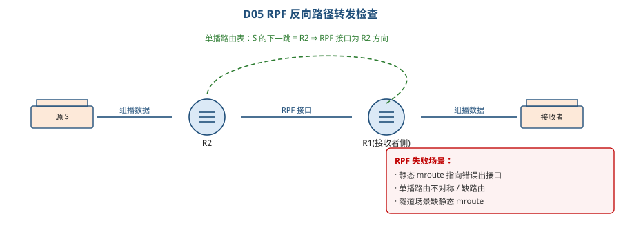

# ch03 RPF、分发树与 PIM 通用机制

> **来源**：Aweya Ch1.6（RPF）、Ch1.10（组播路由体系架构）、Ch3（PIM 报文格式）、Ch5.6（DR 选举）、Ch5.9（Assert）、iPexpert Ch3–Ch4
> **配图**：[D05 RPF](../../diagrams/d05-rpf.svg)｜[D06 分发树](../../diagrams/d06-trees.svg)

---

## 学习目标

1. 解释 RPF 的实现方式（严格 RPF / 静态 mroute / 无 RPF）及其环路风险；
2. 说清 PIM 的通用报文族（Hello/Join-Prune/Assert/Bootstrap/Candidate-RP/Register 等）及其字段；
3. 理解组播路由表（mroute）的表项结构：`(S,G)`、`(*,G)`、`(S,G,rpt)`、RPF 接口、Outgoing List、Flags；
4. 掌握 PIM DR 选举规则与 Assert 机制；
5. 建立"组播转发三要素：状态 + RPF + 出接口列表"的排障框架。

---

## 1. 组播路由体系架构（Aweya 1.10）

四层组件模型，理解它就理解了"一条组播流要经过多少个模块"：

| 组件 | 缩写 | 职责 |
|---|---|---|
| **Multicast Routing Protocol Engine** | MRPE | 协议状态机：处理 Join/Prune/Register 等，维护协议状态 |
| **Multicast Routing Table Manager** | MRTM | 把协议状态 + RPF 信息 → 写硬件 FIB（组播转发表） |
| **Unicast Routing Protocol Components** | — | 提供 RPF 所需的目标源路由信息（IBGP/静态/OSPF/ISIS） |
| **Multicast Group Membership Discovery** | MGMD | IGMP/MLD，负责最后一跳成员发现 |
| **Multicast Source Discovery Protocol** | MSDP | 跨域发现源（ASM 场景） |

> 排障时的价值：判断"是协议状态没建起来（MRPE）"、"是转发表没下发（MRTM）"、"是 RPF 查不到（Unicast）"还是"是成员没加入（MGMD）"——**四选一，缩小 80% 的排查范围**。

---

## 2. RPF 详解



### 2.1 为什么需要 RPF

组播树是以**源为根**的生成树。RPF 保证：

1. **无环路**：任何组播包只能沿"离源越来越近"的方向转发，包不会绕回；
2. **防伪源**：伪造源地址的包没有对应 RPF 接口，直接丢弃；
3. **流量对称**：RPF 保证组播与单播走相同路径，避免环路与路径不一致。

### 2.2 RPF 的三种实现

| 模式 | 配置 | 用途 | 风险 |
|---|---|---|---|
| **严格 RPF** | 默认，基于单播路由表/FIB | 正常组播 | 单播拓扑异常会导致组播不通 |
| **静态 mroute** | `ip mroute <src> <mask> <interface> [rpf]` | 单播不可达场景（隧道、非 PIM 网络） | **极易造成环路**，必须成文设计 |
| **无 RPF** | `ip multicast-routing` 关闭（老设备） | 实验/老设备 | 全网泛洪，慎用 |

### 2.3 RPF 接口的动态性

- RPF 接口 = 单播路由表中到源的**出接口**（Fib path）；
- **周期性校验**：若单播路由变化（如收敛、链路切换），RPF 接口随之改变；组播状态也会随之重建；
- **RPF 接口类型**（Aweya 1.6.5）：

| 类型 | 说明 |
|---|---|
| `n` | Null —— 无路由，RPF 失败 |
| `l` | 线路（点到点） |
| `m` | 多播（Multiaccess） |
| `i` | 静态 mroute 指定 |

### 2.4 排障命令

```cisco
show ip rpf 10.1.1.1                     ! RPF 接口与路由来源
show ip rpf <source> detail              ! 含 RPF 表项与 FIB 细节
show ip mroute                           ! 全部组播路由表
show ip mroute 239.1.1.1                 ! 指定组
show ip mroute 239.1.1.1 detail          ! 含 RPF 邻居与出接口列表
show ip mroute active                    ! 活动状态（（S,G）/( *,G)）
show ip mroute count                     ! 状态数统计
```

---

## 3. PIM 通用报文族（Aweya Ch3）

### 3.1 公共头（PIM Common Header）

```
 0                   1                   2                   3
 0 1 2 3 4 5 6 7 8 9 0 1 2 3 4 5 6 7 8 9 0 1 2 3 4 5 6 7 8 9 0 1
+-+-+-+-+-+-+-+-+-+-+-+-+-+-+-+-+-+-+-+-+-+-+-+-+-+-+-+-+-+-+-+-+
|  Version | Type  |   Reserved    |           Checksum           |
+-+-+-+-+-+-+-+-+-+-+-+-+-+-+-+-+-+-+-+-+-+-+-+-+-+-+-+-+-+-+-+-+
|                        Group Address                           |
+-+-+-+-+-+-+-+-+-+-+-+-+-+-+-+-+-+-+-+-+-+-+-+-+-+-+-+-+-+-+-+-+
|                        Source Address                          |
+-+-+-+-+-+-+-+-+-+-+-+-+-+-+-+-+-+-+-+-+-+-+-+-+-+-+-+-+-+-+-+-+
```

- `Version` = 2，`Type` 区分报文类型；
- 8 bit 保留域在 PIMv2 中被重新定义（Option Type 1–5：Join/Prune 长度、DR 优先级、Generation ID、DF 优先级/生成 ID 等）→ **这是 BIDIR-PIM 能承载 DF 优先级的原因**。

### 3.2 报文清单

| 报文 | 类型 | 归属 | 目的 |
|---|---|---|---|
| Hello | 0 | 全部 | 邻居发现、DR 选举、参数协商 |
| Join/Prune | 1 | 全部 | 建/剪分发树 |
| Assert | 4 | 全部 | 多路访问网段上消除重复转发 |
| Graft / Graft-Ack | 5/6 | PIM-DM | 重新接入被剪掉的支路 |
| State-Refresh | 10 | PIM-DM | 周期刷新 (S,G) 状态 |
| Bootstrap (BSM) | 20 | PIM-SM | 分发 Group→RP 映射 |
| Candidate-RP-Advert | 19 | PIM-SM | 宣告 RP 候选 |
| Register / Register-Stop | 12/11 | PIM-SM | 源注册到 RP |
| BIDIR 专用 | Offer/Winner/Backoff/Pass | BIDIR | DF 选举可靠性增强 |

### 3.3 Hello 报文关键字段

| 字段 | 作用 |
|---|---|
| **Holdtime** | 邻居存活时间，默认 105 s |
| **DR Priority** | DR 选举优先级，数值大者优（默认 1） |
| **Generation ID** | 标识路由器实例，用于 BIDIR DF 选举 |
| **Keepalive Timer** | 双向保活确认，默认 0（关闭） |
| **DR Priority/Neighbor Loss** | 检测邻居丢失 |
| **Bidir-Capable** | BIDIR-PIM 能力标志（RFC 5015） |

**关键定时器汇总**：

| 定时器 | 默认值 | 说明 |
|---|---|---|
| Hello Holdtime | 105 s | 3.5 × Hello interval（30 s） |
| Assert Holdtime | 90 s | |
| Join/Prune Holdtime | 210 s | |
| RP Announce（AutoRP） | 60 s | 宣告周期 |
| BSR RP-Announce | 60 s | |
| SA Advert（MSDP） | 60 s | |
| SA Cache | 180 s | |

---

## 4. 组播路由表 (mroute) 结构

```cisco
IP Multicast Routing Table
Flags: D - Dense, S - Sparse, B - Bidir Group,
       s - SSM Group, C - Connected, L - Local, P - Pruned,
       R - RP-bit set, J - Join SPT, T - SPT-bit set,
       E - Extranet, X - External, H - Hot standby
(*, 239.1.1.1), 00:00:00/32, uptime 00:12:33, expires 00:03:22
  RP 10.1.1.1
  Flags: S
  Incoming interface: GigabitEthernet0/1, RPF
  Outgoing interface list:
    GigabitEthernet0/2, Forward/Sparse, 00:01:22/00:03:20
(10.1.2.5, 239.1.1.1), 00:00:41/00:03:22, flags: JT
  Incoming interface: GigabitEthernet0/1, RPF
  Outgoing interface list:
    GigabitEthernet0/2, Forward/Sparse, 00:00:41/00:03:22
```

**必须能读懂的字段**：

| 字段 | 排障含义 |
|---|---|
| `Flags: JT` | **J** = 已加入 SPT；**T** = SPT-bit 已置（共享树侧被剪） |
| `R` | RP-bit：该组已切换到 SPT（收到 `(S,G,rpt) Prune`） |
| `Incoming interface ... RPF` | RPF 接口是否正确（**RPF 失败的第一现场**） |
| `Outgoing interface list` | 无条目 → 树上无人；接口带 `Pruned` → 被剪 |
| `expires` | 状态老化倒计时 |
| `00:03:20` | 该接口的 Join 定时器（到期未刷新则状态消失） |

> **`show ip mroute` 是组播排障的第一命令**（iPexpert 反复强调：把控制面与数据面分开，先看控制面）。

---

## 5. PIM DR 选举与 Assert

### 5.1 DR 选举（Aweya 5.6.2）

**目的**：多路访问网段上，**每个网段只有一个 DR** 负责：
- 代表本网段向上游发送 Join/Prune；
- 接收上游的 Join/Prune 并在本网段泛洪；
- 源侧 DR 负责向 RP 发 **Register**；
- 收侧 DR 负责执行 **SPT 切换**（最后一跳）。

**选举规则（RFC 7761）**：

1. 比较 **DR Priority**（Hello 中携带），**数值大者胜**；
2. 相同则比较 **Hello 中的源 IP**（接口 IP），**地址小者胜**；
3. 再相同则比较 **Generation ID**（新版）；
4. ** PIM Hello 邻居数最少者优先**（tie-breaker，避免震荡）。

**DR 故障切换**：Holdtime（105 s）超时后重新选举；切换期间组播中断 → 生产上需 **冗余 PIM 域/双上联**。

### 5.2 Assert 机制

**问题**：在多路访问网段（如同一台交换机下多个路由器共享一个 LAN），两台路由器都收到同一份组播包，如果都向下游转发 → **重复流量**，浪费带宽。

**解决**：Assert 报文携带 (S,G) 的 **metric（跳数）**、**RPT-bit 标志**、**preferred flag**（是否走 SPT）。

**Assert 选举优先级**（Aweya 5.9.7）：

1. **SPT preferred 优先**（走 SPT 的胜出，标志位优先）；
2. **RPT-bit 未置者优先**（若都已走 SPT 则此步相同）；
3. **metric 小者胜**（离源更近）；
4. 相同则 **IP 地址小者胜**。

**Assert Winner** 停止转发并宣告；其他路由器收到 Assert 后停止向该网段转发，并安装 Assert 状态，直到 holdtime 到期。

> 排障要点：`show ip mroute <group> detail` 中出现 `Asserts` 段，说明存在重复转发路径；若业务"带宽翻倍"，优先查 Assert。

---

## 6. 生产案例（6 例）

### 案例 3-1：RPF 失败——单播通、组播不通

**现象**：组播全不通，单播正常；`show ip mroute` 中该组无 `(S,G)` 项。
**定位**：
```
show ip rpf 10.1.2.5                 ! RPF interface: Null / 不符
show ip route 10.1.2.5               ! 单播路由是否存在
debug ip mpacket 10.1.2.5 239.1.1.1  ! 见 "RPF failed" / "no route"
```
**根因**：路由器缺少到源的**单播路由**（PIM 依赖 IGP，不自带路由）。
**处置**：补齐到源的路由（IGP/静态），**不要**用静态 mroute 掩盖问题。
**复盘**：PIM 域规划必须"一个 IGP 域 + 全网启用 PIM"，这是 iPexpert 反复强调的铁律。

### 案例 3-2：静态 mroute 造成组播环路

**现象**：同组流量在两台设备间来回转发，带宽翻倍，且 TTL 异常。
**定位**：`show ip mroute` 显示 RPF 接口为静态指定（`i`）；`debug ip mpacket` 显示包在两台设备间循环。
**根因**：为解决 RPF 失败而配置的静态 mroute 指向了错误方向。
**处置**：删除静态 mroute，改为补齐单播路由；确需静态 mroute 时在设计文档中写明理由与环路分析。
**复盘**：静态 mroute 是"最后手段"，每次使用都要有环路风险评估（与你的笔记一致）。

### 案例 3-3：DR 频繁切换导致组播周期性中断

**现象**：组播每 1~2 分钟中断几秒，客户端频繁重连。
**定位**：`show ip pim interface` 显示 DR 反复变化；`show logging | include PIM` 出现 `DR changed`。
**根因**：两台路由器的 **DR Priority 相同且接口 IP 相同**（如主备设备同 IP 未规划），或 Hello 被 ACL/认证阻塞导致邻居反复重建。
**处置**：显式配置不同 `ip pim dr-priority`；检查 `ip pim hello` 邻居是否稳定（`show ip pim neighbor`）。
**复盘**：PIM 邻居与 DR 选举必须纳入变更检查单。

### 案例 3-4：组播重复转发，带宽占用翻倍

**现象**：交换机上该组流量是两倍预期；客户端正常但带宽异常。
**定位**：`show ip mroute 239.1.1.1 detail` 出现 `Asserts`；`show ip pim neighbor` 显示同一网段两台 DR。
**根因**：多路访问网段上 Assert 未生效或配置了 `ip pim assert` 关闭/ACL 拦截 Assert。
**处置**：确认 Assert 报文未被过滤；检查是否有 `no ip pim sparse-mode` 接口混入。
**复盘**：多路访问网段必须验证 Assert，尤其是双归接入场景。

### 案例 3-5：mroute 状态存在但数据不转发

**现象**：`show ip mroute` 有 `(S,G)` 且 Outgoing interface list 有接口，但接收端收不到。
**定位**：`show ip mroute 239.1.1.1 detail` 看 Outgoing 接口的标志（是否 `Pruned`/`Forward`）；`show ip igmp groups` 看成员；接口 `show ip pim interface`。
**根因**：出接口列表中的接口处于 **Pruned** 状态，或该接口没有 IGMP 成员（末端主机已离开但状态未刷新）。
**处置**：确认 Join/Prune 交互；检查下游接口是否 `ip pim sparse-mode`。
**复盘**：mroute 有条目 ≠ 能转发，必须看 Outgoing list 的细节标志。

### 案例 3-6：组播 TTL 被逐跳改写导致边界行为异常

**现象**：跨三层设备后组播突然消失。
**定位**：`debug ip mpacket` 显示 TTL=1；`show ip mroute` 中组被 prune。
**根因**：某台设备出接口未配 `ip multicast ttl`，默认 TTL=1 阻断转发；或 `ip multicast threshold` 设置过低。
**处置**：出接口 `ip multicast ttl 255`；检查 threshold 与域边界设计。
**复盘**：组播 TTL 是"逐跳重写"而非"递减"，配置时按"域边界"而不是"跳数"思考。

---

## 7. 自测清单

1. MRPE / MRTM / MGMD / MSDP 四个组件分别负责什么？排障时如何用它们定位问题层次？
2. 严格 RPF 与静态 mroute 的差别是什么？各自的环路风险？
3. `show ip mroute` 中 `J`、`T`、`R`、`P` 四个标志分别代表什么？
4. PIM DR 选举的完整比较顺序是什么？为什么 IP 地址"小者胜"？
5. Assert 选举的四步优先级是什么？为什么要把 "SPT preferred" 放在 metric 之前？
6. Hello holdtime 是多少？它与 Hello interval 的比例关系是什么？为什么是 3.5？

## 8. 延伸阅读

- Aweya Ch1.6 / Ch1.10（P.60–P.79）、Ch3（P.169–P.188 报文格式）、Ch5.6（P.262–P.269）、Ch5.9（P.285–P.292）
- Williamson 附录 A（P.526–P.541）：PIM 报文格式速查
- 延伸：`RFC 7761`（PIM-SM）、`RFC 5015`（BIDIR-PIM）、`RFC 3974`（MSDP）
