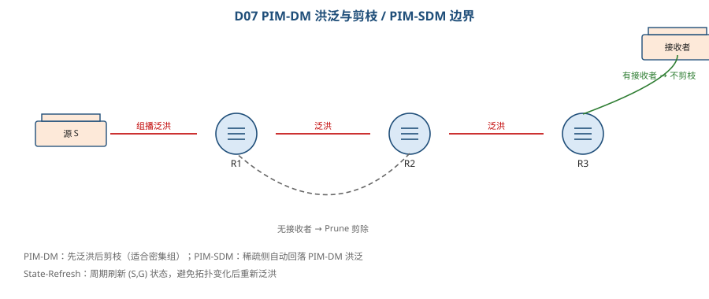
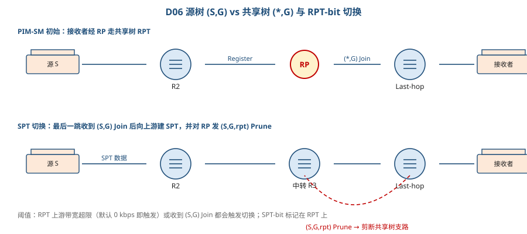

# 第 4 章 PIM-DM：推模型与泛洪-剪枝

> 精读来源：**Williamson Ch2（p.46–48，Dense Mode 只用 SPT、Prune 状态机）、Ch10（"Using PIM Dense Mode"，p.42 明确指向该章）**、**Aweya Ch1（p.16–18）、Ch3（p.148–150，Graft/Graft-Ack 报文类型）**
> 本章解决的问题：没有 RP、没有接收者信息时，**怎么"先送出去再收回来"**——以及这个模型为什么在现网基本被淘汰，却仍然值得学。

## 学习目标

1. 说清 PIM-DM 是"隐式 join"（implicit join）：为什么泛洪本身就是一种加入；
2. 画出初始泛洪 → Prune → 重新泛洪的完整时序；
3. 记住 Prune 定时器（210 s）与 State Refresh（60 s）的关系，解释"3 分钟抖动"这一经典现象；
4. 说清 Graft 的触发与报文类型（6/7），以及它为什么是单播；
5. 说明 PIM-DM 只用 SPT、状态数 = 源数 × 组数 的后果；
6. 判断什么场景下 DM 反而比 SM 合适（以及绝大多数场景不适用的原因）。

---

## 1. 推模型：先送，再问"要不要"

Aweya p.16 的原文措辞很准确：**PIM-DM 采用 "implicit join model"，路由器用 "flood-and-prune" 行为**——没有显式的加入流程，**泛洪到达即等于加入**。

对比两种模型的本质差别：

| 维度 | PIM-DM（推） | PIM-SM（拉） |
|---|---|---|
| 初始行为 | 收到第一个包就朝所有 PIM 邻居泛洪 | 只朝有 Join 的路径发 |
| 接收者信息 | 事后通过 Prune 得到 | 事前通过 Join 得到 |
| 树 | **只用 SPT（S,G）** | RPT（*,G）+ 可选 SPT |
| 状态数 | 源数 × 组数 | 组数（RPT）+ 活跃源的 SPT |
| 首包延迟 | 低（不等建树） | 高（等 Join/注册） |
| 带宽浪费 | 收敛期显著 | 几乎无 |

Williamson p.46 明确写着：**"Dense mode protocols such as DVMRP and PIM-DM employ only SPTs"**——DM 里不存在共享树，这是它状态爆炸的根据。

---

## 2. 五个阶段：从泛洪到稳定

### 阶段 1：初始泛洪（Flood）

源 S 发出第一个包 → 源 DR 从**所有 PIM 接口**泛洪（除入接口）→ 每台路由器做 RPF 检查：

- RPF 通过 → 继续朝下游泛洪，并建（S,G）；
- RPF 失败 → 丢弃（这就是"泛洪不会成环"的原因）。

### 阶段 2：剪枝（Prune）

叶路由器发现"本网段没有接收者（无 IGMP 成员、无下游 PIM 邻居）" → 向上游发 **Prune**。

上游收到 Prune 后把该接口置为 **Pruned 状态**（W p.47 原文："the router places that interface into Pruned state"），并：
- 若所有下游接口都被剪掉 → 继续向上游发 Prune；
- 若还有其他下游 → 只剪这一个口。

### 阶段 3：Prune 超时与重新泛洪

W p.47 的关键一句：**"Prunes have a timeout value associated with them such that, when they time out, they cause…"**——剪枝状态会过期，过期后流量**重新泛洪**下来，再被重新剪掉。

```text
210 s（默认 Prune 超时）→ 状态失效 → 重新泛洪 → 重新剪枝
```

这就是 PIM-DM 的经典缺陷：**在没有任何接收者的分支上，每 3 分钟仍会有一次泛洪**。

### 阶段 4：State Refresh（RFC 3973 的补丁）

为解决"周期性泛洪"，PIM-DM 引入 **State Refresh** 报文：上游每 **60 s** 向下游发一次"剪枝状态仍然有效"，下游据此刷新 Prune 定时器，**不必等超时再泛洪**。

前提：**整域内所有路由器都支持并启用 State Refresh**（Hello 里带 Option 6）。只要有一台老设备不支持，退化回 210 s 泛洪。

### 阶段 5：Graft（新接收者加入）

被剪掉的分支来了新接收者时，不需要等 3 分钟：路由器发 **Graft**（类型 **6**）**单播**沿 RPF 方向逐跳上行，上游回 **Graft-Ack**（类型 **7**）（Aweya p.149–150 原文列出这两类报文与"Unicast to RPF interface of source"）。

```text
新成员出现 → 叶路由器发 Graft（单播） → 上游立即恢复转发 → 回 Graft-Ack
```

---

## 3. Assert 在 DM 里更频繁

DM 的泛洪特性使"同一网段多台上游都往下发"的概率大增，Assert（第 3 章）在 DM 域里会**非常频繁**地触发。这也是 DM 在共享 LAN（尤其是双上联）里表现差的原因之一。

---

## 4. 配置（Cisco）

```cisco
ip multicast-routing
interface GigabitEthernet0/1
 ip pim dense-mode            ! 老写法；新平台为 ip pim dense-mode / sparse-dense-mode
! 边界（必须有，否则泛洪出域）
ip access-list standard DM-BOUNDARY
 permit 239.0.0.0 0.255.255.255
interface GigabitEthernet0/0
 ip multicast boundary DM-BOUNDARY
```

排障命令：

```cisco
show ip mroute                     ! 看 (S,G) 的 flags：D= Dense, P= Pruned
show ip mroute 239.1.1.10          ! 看各接口状态：prune/dense
show ip pim interface              ! 模式与邻居数
show ip pim neighbor
debug ip pim                       ! 看 prune/graft（高 CPU 风险）
```

---

## 5. 拓扑图



**图 4-1 泛洪-剪枝**：源 S 首包朝所有 PIM 接口泛洪（绿线）；无接收者的分支发 Prune（红线）后被置为 Pruned；210 s 后状态失效会重新泛洪（虚线），除非启用 State Refresh。



**图 4-2 为什么 DM 只有源树**：左侧（S,G）源树就是 DM 的全部；DM 不使用中间那棵（*,G）共享树，因此每个源都要独立建树。

---

## 6. 工程案例（8 例）

### 案例 4-1：DM 域每 3 分钟一次"无缘无故的带宽尖峰"

**现象**：某工厂监控网用 PIM-DM，核心-分支专线每约 3 分钟出现一次 30 Mbps 尖峰（该分支无任何接收者），持续 1–2 秒。

**定位**
```cisco
show ip mroute 239.1.1.20          ! 分支侧无 (S,G)；上游接口周期性 prune
show ip mroute 239.1.1.20 count     ! 上游计数每 210 s 增加
show ip pim neighbor detail        ! Hello 选项中无 "State Refresh"
```
**根因**：Prune 超时 **210 s** 后状态失效 → 重新泛洪 → 被重新剪掉。域内混入了不支持 State Refresh 的老设备，导致整域退化。

**处置**：全域名设备启用 State Refresh（`ip pim state-refresh origination-interval 60` 源侧 + 全域名支持）；无法统一时改用 **PIM-SM**。

**复盘**：**看到"≈210 s（3 分半）周期"的异常，直接判定 PIM-DM Prune 超时**，不必查数据面。

### 案例 4-2：DM 网络里加一个新接收者，要等 3 分钟才有画面

**现象**：新开一个监控终端，加入后要 2–3 分钟才出图。

**定位**
```cisco
show ip mroute 239.1.1.20          ! 该分支接口处于 pruned
debug ip pim graft                 ! 无 Graft 发出
```
**根因**：Graft 依赖"接口状态仍存在但被剪"；若该（S,G）在上游已**超时删除**（而非仅 Pruned），新成员加入只能等下一条数据触发重新泛洪。加上 Graft 的 RPF 上游若配置了 `ip pim dense-mode` 但中间链路丢包，Graft-Ack 丢失会重试。

**处置**：确认 State Refresh 启用（保证状态不消失）；中继链路检查 MTU/分片（Graft-Ack 很小，一般不是 MTU 问题）；开启 `ip pim state-refresh` 后延迟降到秒级。

**复盘**：**DM 的加入延迟取决于"状态是否还在"**，不是"配置对不对"。

### 案例 4-3：DM 泛洪打满低带宽专线，业务中断

**现象**：某分支 2 Mbps 专线，总部推 6 Mbps 视频，分支无接收者，但专线被打满。

**定位**
```cisco
show interface Serial0/0/0 | include "output rate"
show ip mroute 239.1.1.30          ! 分支侧 pruned，但每 210 s 泛洪一段
```
**根因**：DM 的初始泛洪与周期泛洪不看下游带宽；加上**未配置边界**，整段 239/8 都在泛洪。

**处置**：边界 ACL 只放行业务组；专线侧对组播做限速（`rate-limit`/QoS policing）；架构上改为 SM。

**复盘**：**DM 与低带宽/高延迟链路天生不兼容**。凡是 WAN 场景，一律不选 DM。

### 案例 4-4：DM 域内状态数爆炸，设备内存告警

**现象**：500 路源 × 20 个组，核心路由器 mroute 条目 10 万+，CPU 40%，内存告警。

**定位**
```cisco
show ip mroute summary             ! 条目数
show ip mroute count | include "Group"
```
**根因**：DM 只用 SPT，状态数 = **源数 × 组数**；而其中大量源长期无接收者，状态只靠 Prune 维持，永远不释放。

**处置**：迁移 PIM-SM（状态数降到组数量级，且可用 `spt-threshold infinity` 进一步压）；短期加 `ip pim dense-mode` 的边界与源过滤。

**复盘**：**状态规模是选择 DM/SM 的第一判据**，不是"哪种更简单"。

### 案例 4-5：DM 与 SM 混跑，边界处形成环路

**现象**：改造期部分区域用 SM、部分用 DM，边界出现重复包与"流量绕两圈"。

**定位**
```cisco
show ip mroute 239.1.1.40          ! 同一 (S,G) 在两个方向都有 OIF
debug ip pim                       ! 看到 prune 与 join 交替
```
**根因**：DM 的泛洪不认 SM 的（*,G）状态，SM 的 RP 又对 DM 域泛洪"不设防"，两边都把对方当"下游"，形成**推-拉冲突**。

**处置**：边界路由器用 `ip pim sparse-dense-mode` 并在边界做**组播边界 + 明确的 RP 覆盖范围**；改造应"按域切换"，避免长期混跑。

**复盘**：**DM/SM 混合是事故高发区**，必须画出"哪个域用哪种模式"的边界图。

### 案例 4-6：`show ip mroute` 显示 D 与 P 同时存在，误判为故障

**现象**：运维看到 `(S,G) flags: D P`，以为状态异常。

**定位**
```cisco
show ip mroute 239.1.1.50
! (10.1.1.100, 239.1.1.50), flags: D  ← Dense
!   Incoming interface: Gi0/0, RPF nbr 10.1.1.2
!   Outgoing interface list:
!     Gi0/1, Forward/Dense, 00:00:12/00:02:48
!     Gi0/2, Prune/Dense, 00:02:30/00:00:30   ← P 表示该口被剪
```
**根因**：不是故障。`D` 表示该路由是 Dense 模式条目，`Prune/Dense` 表示**该出接口**处于剪枝状态。

**处置**：无需处置；把 `Forward/Dense` 与 `Prune/Dense` 的区别写进运维手册。

**复盘**：**读懂 flags 能省一半无效工单**。DM 的核心 flag 只有 D、P、A（Assert）。

### 案例 4-7：源侧 DR 不是预期设备，注册/泛洪路径错

**现象**：多台路由器接同一服务器网段，泛洪从"非预期"的那台出去，绕行 3 跳。

**定位**
```cisco
show ip pim interface Gi0/3        ! DR 字段显示非预期设备
show ip pim neighbor              ! 各台 DR priority
```
**根因**：DM 里 DR 主要承担 IGMP Querier 与本地转发职责，选举按 priority/IP；网段内 IP 最大的设备当选，而设计上希望"出口路由器"当选。

**处置**：出口路由器设 `ip pim dr-priority 100`；其他设默认。

**复盘**：**DR 要显式设计**（与第 3 章同一结论）。

### 案例 4-8：DM 用于小规模监控网反而最省事（正面案例）

**现象**：某园区 3 台路由器、1 个源、8 个接收者，全部在同一广播域内，用 SM 需配 RP、易出错。

**定位**：规模评估——源 1 个、组 3 个、域内 3 跳。

**结论**：改用 PIM-DM 后配置只有 3 行（`ip multicast-routing` + 接口 `ip pim dense-mode`），无 RP、无 MSDP，稳定运行。

**复盘**：**DM 并非"技术落后"，而是"规模不经济"**。源少、组少、域小、带宽充裕的场景，DM 的运维成本最低。判断标准：**状态数（源×组）< 100 且域内无 WAN 链路**。

---

## 7. 自测清单

1. 什么是 "implicit join"？它和 SM 的显式 Join 有何本质差别？
2. PIM-DM 的初始泛洪为什么不会成环？
3. Prune 的默认超时是多少？超时后会发生什么？
4. State Refresh 解决什么问题？它成立的前提是什么？
5. Graft 是单播还是组播？为什么？
6. Assert 在 DM 中为什么更频繁？
7. DM 的状态数公式？为什么它会"内存爆炸"？
8. `Forward/Dense` 与 `Prune/Dense` 的区别？
9. 什么规模的网络适合 DM？给出三个判据。
10. DM 改造为 SM 时，最先要处理的是什么（提示：边界与 RP）？

---

## 8. 原文精读索引

> 纸面页码实测：Williamson = PDF 页 − 21；Aweya = PDF 页 − 21。

| 知识点 | 书/节 | 纸面页 | 原文可核对要点 |
|---|---|---|---|
| 密集/稀疏两种模型 | W Ch2 | p.46 | "Dense mode protocols (DVMRP and PIM-DM)"；"employ only SPTs" |
| Flood and Prune 行为 | W Ch2 | p.46–47 | Prune 把接口置 Pruned 状态；Prune 有超时，超时后重新泛洪（Figure 2-20） |
| 推模型的适用与代价 | W Ch2 | p.48 | 密集模式在成员稀疏时浪费带宽 |
| PIM-DM 详细章节指引 | W Ch2 | p.42 | 原文指向 "Chapter 10, Using PIM Dense Mode" |
| implicit join / flood-and-prune | Aweya Ch1 | p.16–17 | "PIM-DM operates on an implicit join model" |
| SM 与 DM 的模型对比 | Aweya Ch1 | p.17–18 | 稀疏模式显式 join；密集模式初始泛洪 |
| Graft / Graft-Ack 类型值 | Aweya Ch3 | p.149–150 | "6 = Graft (PIM-DM only)"、"7 = Graft-Ack (PIM-DM only)"；Graft 单播至 RPF |
| Join/Graft 对 Hold Time 的影响 | Aweya Ch3 | p.163 | 收到 Join 或 Graft 会刷新 Hold Time |
| Prune 210 s / State Refresh 60 s | RFC 3973 | — | 标准默认值；本书未逐字给出数值，按 RFC 标注 |
| PIM-DM 泛洪-剪枝-嫁接全流程 | W Ch6 | p.129、132 | 状态机演进与 RPF 检查的触发点 |
| DVMRP 的 prune/graft 对照 | W Ch5 | p.47–53 | 老协议怎么剪枝，PIM-DM 沿用了哪些字段 |
| PIM-DM 邻接与状态排障 | iP Ch3 | PDF p.55–60 | Hello/邻居建立与 `show ip mroute` 输出 |
| PIM Sparse-Dense 接口模式 | iP Ch5 | PDF p.155–164 | 接口级 dense/sparse 混跑与迁移 |
| Graft / Graft-Ack 的报文与流程 | Aweya §3.3.1 | p.163–169 | 嫁接请求的重传与确认 |
| State Refresh 机制 | Aweya | p.272–278 | 避免剪枝超时后重新泛洪的开销 |

---

## 9. 延伸

- 下一章：PIM-SM 与 RP 发现（全书的重点，也是现网默认选项）
- 标准：RFC 3973（PIM-DM）、RFC 4601（PIM-SM）
- 迁移建议：DM → SM 必须"按域切换 + 明确 RP 与边界"，不要长期混跑
