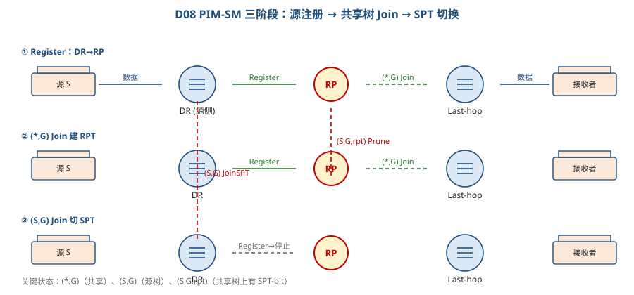
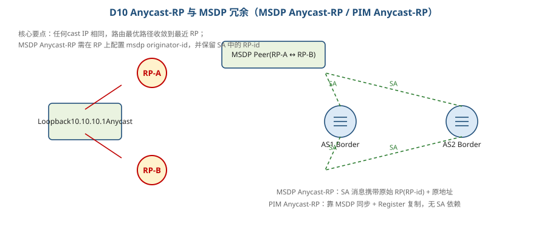

# 第 5 章 PIM-SM：Register、SPT 切换与 RP 发现

> 精读来源：**Aweya Ch5（§5.7 Register p.249–272、§5.14 SPT 切换 p.286–292、§5.16 RP 发现 p.301–332）**、**Williamson Ch5–Ch6（p.150–162，共享树与 SPT joins/prunes）、p.164（Register-Stop 语义）**
> 本章解决的问题：组播的"拉模型"里，**源不知道谁要收、接收者不知道源在哪**——RP 用一个固定汇合点把两件事解耦。代价是三条额外路径（注册隧道、RPT、SPT 切换）和四套发现机制。

## 学习目标

1. 说清 RP 到底解决什么问题：**源的"上"与接收者的"下"如何在 RP 处对接**；
2. 画出完整时序：IGMP → `(*,G)` Join 逐跳 → Register 封装 → `(S,G)` Join → SPT 切换 → `(S,G,rpt)` Prune；
3. 分清四个易混概念：`Register` / `Register-Stop` / `Null-Register` / `Register-Suppression`；
4. 解释 SPT 切换的三个判据（S 位、阈值、最后一跳发起）以及切换后为什么必须发 `(S,G,rpt)` Prune；
5. 对比四种 RP 发现方式（静态 / Auto-RP / BSR / Anycast）的**故障域**，而不是只背配置；
6. 在 `show ip mroute` 与 `show ip pim rp mapping` 之间建立对应关系，看到 `R`/`T`/`J` 标志就知道卡在哪一段。

---

## 1. 问题定义：SM 要解决的是"两头互不知情"

| 角色 | 知道什么 | 不知道什么 |
|---|---|---|
| 源（首跳 DR） | 自己在发 `(S,G)` | 有没有接收者、在哪 |
| 接收者（最后一跳 DR） | 有人要 `G` | 源在哪、源是否已经发流 |
| RP | 全组的 `(*,G)` 状态 | 只有注册或 Join 告诉它的事 |

三种结合方式：

- **共享树（RPT）**：接收者朝 RP 逐跳 Join `(*,G)`，RP 成为"已知的唯一汇聚地址"；
- **注册**：源的 DR 把数据封装成单播 `Register` 直接投给 RP，RP 据此知道"有这个源"；
- **切换**：最后一跳发现流量够大，改走源最短路径，同时把 RPT 剪掉。

> Williamson p.150 特别提醒用词：**"共享树"不要和"源树/最短路径树"混称**——原书把 `(*,G)` 叫 shared tree / RPT，把 `(S,G)` 叫 source tree / SPT。现网排障里"树没建起来"必须问清是哪棵树。

---

## 2. 第一段：接收者如何把 `(*,G)` 送到 RP

### 2.1 逐跳过程

```
Host ── IGMP Report ──> 最后一跳 DR
DR: 查 RP(G) ──> 查单播路由到 RP ──> 出接口 = RPF 接口
DR 发 (*,G) Join（目的 224.0.0.13，TTL=1）给 RPF 邻居
每一跳重复：查 RP → 查去 RP 的单播路由 → 继续上行
到达 RP：RP 建 (*,G)，出接口表加入该下游
```

关键点：**Join 的目的地址永远是 224.0.0.13（All-PIM-Routers），逐跳单播给 RPF 邻居**。所以"Join 发不出去"永远先看两件事：`show ip rpf <RP>` 是否可达、RPF 接口上是否启了 PIM。

### 2.2 RP 的特殊性：`(*,G)` 没有"源"可查

普通 `(S,G)` 的 RPF 是"去往 S"。`(*,G)` 的 RPF 是"去往 RP"。这导致两类常见误判：

- RP 自己有 `(*,G)` 但出接口为 Null → 正常（RP 是树根）；
- 非 RP 路由器上 `(*,G)` 的入接口不是去 RP 的最短路 → 说明 RP 地址选错了（静态/BSR/Auto-RP 不一致），而不是"树坏了"。

```bash
show ip mroute 239.1.1.1                 # 看 (*,G) 的 Incoming interface
show ip rpf 10.1.1.1                     # 与 Incoming interface 对比
show ip pim rp mapping                   # 本机认为的 RP 是谁
```

---

## 3. 第二段：Register——源怎么"报到"

### 3.1 报文与语义

`Register` 是**单播** PIM 报文（不是 224.0.0.13），载荷里装的是完整的组播数据包（IP-in-IP 式封装）。首跳 DR 把源发来的每个包封装后单播给 RP：

- 外层：DR → RP 的单播头；
- 内层：原始的 `(S,G)` 组播包。

Aweya p.268–272 明确写了 RP 解封装后的两个细节，很多人不知道：

1. **RP 转发解封装后的包时会 TTL 减 1**（相当于经过了一跳）；
2. **RP 把 Register 外层的 ECN 位与 DSCP 复制到内层组播包**上——所以"经过 RP 后 QoS 标记变了"可以在 RP 上找到原因，而不是怀疑上游。

### 3.2 四种"停止/继续"机制

| 机制 | 发起方 | 作用 | 默认值 |
|---|---|---|---|
| `Register-Stop` | RP → 首跳 DR | 我不需要这个 `(S,G)`，别再发了 | 携带 `(S,G)` |
| Register-Suppression | DR 本地定时器 | 收到 Stop 后静默期，不再封装 | 60 s（Aweya p.249） |
| `Null-Register` | DR → RP | 静默期结束前的"探针"：还不需要数据吗？ | 探测时间见 p.249 |
| `(S,G)` Join | RP → 源 | 我需要，直接送过来（不再用隧道） | 触发式 |

**这一组机制是全章最容易被误解的地方**：`Register-Stop` 不是永久拒绝，只是一个定时静默。静默期到点后 DR 必须用 `Null-Register`（空载荷 Register）重新问一次，否则 RP 在上游重新出现接收者时**永远等不到数据**——这就是"新用户加入后 1 分钟内无流量"的一类根因。

Aweya p.249–250 还给了 RP 侧的保护：RP 为注册建立的 `(S,G)` 状态至少保留 **3 × Register_Suppression_Time**，并把 Keepalive 定时器设为 **3 × Register_Suppression_Time + Register_Probe_Time**。否则 RP 可能在 DR 停止注册之前就把 `(S,G)` Join 撤掉，数据出现空窗。

### 3.3 RP 侧的 RPF 校验

Register 到达 RP 后，RP 要判断"这个源到我这的路径对不对"：

- 通过 → 解封装、建 `(S,G)`、朝 RPT 下游转发、并向源发 `(S,G)` Join；
- 不通过 → 丢弃并回 `Register-Stop`（`Register` 里带 Border 位等标志，不同实现细节有差异）。

> 现网推论：**RP 必须有一条去往源的单播路由，且这条路由的下一跳方向要和源的 DR 一致**。RP 位于网络中心、源在分支时，如果 RP 侧做了路由汇总或策略路由，注册会被静默丢弃——比"配置错误"更难查，因为**数据面上你能看到 Register 在进，但 `(S,G)` 建不起来**。

---

## 4. 第三段：SPT 切换——为什么"能通"还要切

### 4.1 切换的三个判据

| 判据 | 说明 | 原文 |
|---|---|---|
| 谁发起 | **最后一跳（接收者侧 DR）** 发起，不是 RP | Aweya §5.14 |
| 何时发起 | 收到第一个包即可切（阈值默认 0 kbps），或超过配置速率阈值 | Aweya p.288：`a traffic rate threshold (specified in kilobits)` |
| 怎么切 | 向源发 `(S,G)` Join；同时向 RP 发 `(S,G,rpt)` Prune | Aweya p.290–292 |

阈值默认 0 的含义是"**立刻切换**"，所以现网绝大多数 PIM-SM 流量在第一个包之后就走了 SPT，RPT 只承担"首包引路"。这也解释了为什么"RPT 利用率低"是正常现象。

### 4.2 `(S,G,rpt)` 为什么必须发

切换后，流量会**同时**从两条路径到达最后一跳：SPT（源）与 RPT（RP）。

- `(S,G)` 的 RPF 接口 = 去源的最短路 → 从 RPT 来的包 RPF 失败被丢弃（这就是"切换后双份流不会真的双份到桌面"的原因）；
- 但上游到 RP 的整条 RPT 分支仍在转发 → 浪费带宽；
- `(S,G,rpt)` Prune 沿 RPT 上行，一路剪到 RP，才真正省下带宽。

```bash
show ip mroute 239.1.1.1 | include 10.1.1.1
# (10.1.1.1, 239.1.1.1), 00:12:03/00:02:57, flags: JT
#   Incoming interface: GigabitEthernet0/1  <- 去源（SPT）
#   RPF nbr: 10.0.0.2
#   Incoming interface: GigabitEthernet0/0  <- 去 RP（RPT）
#   RPF nbr: 10.0.0.1
```

**读法**：`J` 表示加入 SPT，`T` 表示"还要发 `(S,G,rpt)` Prune 到 RP"，`R` 出现在 RP 侧表示该 `(S,G)` 是通过注册建立。三个标志缺一，就对应一类具体故障（见案例 2、3、5）。



---

## 5. 第四段：RP 发现——四种机制，四个故障域

| 机制 | 谁告诉谁 | 报文/地址 | 冗余方式 | 主要故障域 |
|---|---|---|---|---|
| 静态 RP | 人工 | 无 | 配多个 `ip pim rp-address` + ACL 分范围 | 忘配、范围重叠、与动态冲突 |
| Auto-RP | C-RP → MA → 全体 | 224.0.1.39 / 224.0.1.40 | 多 MA | TTL、sparse-dense、RPF |
| BSR | C-RP → BSR → 逐跳 BSM | 单播 Advertise / 224.0.1.40 | 多 C-BSR | BSM 被过滤、优先级 |
| Anycast-RP | 同一 RP 地址多台 | IGP + MSDP 或 RFC 4610 | 天然 | 状态不同步、MSDP 未建 |

### 5.1 静态 RP

最可靠也最容易埋雷：**没有协商，就没有"不一致告警"**。多台路由器手工配置时，漏配、写错范围、ACL 覆盖顺序错误都不会报错。

### 5.2 Auto-RP（Cisco 私有）

Aweya p.303 的措辞值得记住：Auto-RP 由 Cisco 提出、**已被 BSR 机制取代（obsoleted）**，但仍大量存在于现网。

- `C-RP` 周期性向 **224.0.1.39** 发 Announce（声明"我是哪些组的 RP"）；
- `Mapping Agent` 监听 announce，向 **224.0.1.40** 发 Discovery（下发最终映射）；
- 同一组范围有多个 C-RP 时，**MA 选 IP 最高的**（Aweya p.304）；
- MA 之间也会选（p.305–306），未当选的停止发送 Discovery，当选的继续。

两个必须知道的现网约束：

1. **接口需要 `sparse-dense-mode`**（或 dense 泛洪可用），因为 224.0.1.39/40 需要先泛洪才能被听到；
2. **TTL 默认很小**，跨 WAN 时被 scope 边界挡住是高频故障——announce 出不了本区。

### 5.3 BSR（标准）

- `C-RP` **单播** `Candidate-RP-Advertisement` 给 BSR（Aweya p.320、p.322–323）；
- `C-BSR` 之间选举：先比 **BSR Priority**（大者胜），相同比 IP（大者胜）（p.313、p.317）；
- 当选 BSR 汇总后发 **Bootstrap（BSM）**，逐跳 224.0.0.13/224.0.1.40 泛洪到全域；
- C-RP 的优先级 **Priority 0 最高**（p.323），与"数值越大越优先"的直觉相反——这是配置评审时最常见的一句话错误；
- 有 C-RP 下线时会立刻发 Advertise 撤回（p.323），所以"BSR 表里还有已下线的 RP"通常意味着报文丢了。

### 5.4 Anycast-RP

为一个组配多台 RP、**共用同一个 loopback 地址**，IGP 做等距/就近。两种实现：

- **MSDP 型**：RP 之间建 MSDP 全互联，源注册信息用 SA 互传；
- **PIM Anycast-RP（RFC 4610）**：Aweya p.331–332 明确指出——**不需要 MSDP**，RP 之间用 PIM 自身的 Anycast-RP 机制同步注册信息。

> 这条区别很实用：现网有人看到"Anycast-RP 必须配 MSDP"的说法就把 MSDP 也上了，结果多了一套要维护的会话；用 RFC 4610 实现（如 `ip pim anycast-rp`）可以只保留 PIM。



---

## 6. 定时器与状态速查

| 项目 | 默认/典型值 | 出处 |
|---|---|---|
| Join/Prune 周期发送 | 60 s | Aweya p.260 |
| `(*,G)`/`(S,G)` 状态超时 | 210 s（3.5 × 60） | Aweya p.191 |
| Register 抑制 | 60 s | Aweya p.249 |
| RP 侧 `(S,G)` 保留 | ≥ 3 × 抑制时间 | Aweya p.269 |
| C-RP Advertisement 周期 | 60 s（可配） | Aweya p.322–323 |
| Assert 超时 | 180 s | RFC 7761 |
| DR 优先级 | Hello Option 19，0 = 弃权 | Aweya p.154–155 |

---

## 7. 八个工程案例

> 以下均为**典型化场景**（按现网高频故障构造），用于训练"症状 → 命令 → 根因"的推理，不是某次具体故障的取证。

### 案例 1：源在发、RP 在收，接收者全空

- **现象**：源端 `show ip mroute` 有 `(S,G)` 且计数增长；RP 上只有 `(*,G)`，无 `(S,G)`；接收端 `ping 239.x` 不通。
- **定位**：`show ip pim tunnel`（RP 上是否有 Register 隧道）、`debug ip pim 239.1.1.1`（看 Register 是否被丢弃）、`show ip rpf <S>`（RP 侧）。
- **根因**：RP 到源的单播路由下一跳与源 DR 不同向（汇总/策略路由），Register 被 RPF 检查丢弃。
- **处置**：修正 RP 侧回程路由，或在 RP 上为源段加更具体路由。
- **复盘**：**"RP 必须能沿源的来路回去"**——组播的 RPF 会沿着单播路径反向验证，汇总路由是常见杀手。

### 案例 2：流量通了但只有 1 Mbps，`show ip mroute` 无 `J` 标志

- **现象**：接收端能收到流，但带宽只有源速率的 1/10；最后一跳 `(S,G)` 的 flags 里没有 `J`，From 是 `Register` 隧道。
- **定位**：`show ip mroute 239.1.1.1`（看 flags）、`show ip rpf <S>`（最后一跳）。
- **根因**：SPT 切换未发生——最后一跳去源的单播路由不可达（或经防火墙被拦），只能靠 RP 的 RPT 转发。
- **处置**：修通去源的单播路由；临时可接受 RPT 承载但吞吐受 RP 限制。
- **复盘**：**`J` 缺失 = 没切 SPT**，不是"树没建"；`R` 出现在 `(S,G)` 上说明该条目由注册建立。

### 案例 3：切到 SPT 后上游带宽没降，RP 侧一直有流量

- **现象**：接收端已切 SPT，但 RP 到上游的 RPT 链路利用率不降；RP 上 `(S,G)` 出接口仍活跃。
- **定位**：`show ip mroute 239.1.1.1`（最后一跳是否有 `T` 标志）、RP 上 `show ip mroute 239.1.1.1 count`。
- **根因**：`(S,G,rpt)` Prune 未送达（中间设备 ACL 拦 PIM、或某跳对 `(S,G,rpt)` 处理异常），RPT 分支未剪。
- **处置**：放通 PIM（IP 协议号 103）与 224.0.0.13；逐跳核对 prune 是否被丢弃。
- **复盘**：**切换只完成了一半**——"改走 SPT"和"剪掉 RPT"是两个动作，后者失败不影响连通性，只浪费带宽，因此长期无人发现。

### 案例 4：Auto-RP 只有本部生效，分支全走错 RP

- **现象**：总部区域正常；分支 `show ip pim rp mapping` 显示 `?` 或旧 RP。
- **定位**：`show ip pim rp mapping`、`show ip mroute 224.0.1.40`（分支是否收到 Discovery）、`show ip pim interface`（是否 `sparse-dense-mode`）。
- **根因**：224.0.1.40 的 TTL 默认 32 仍被 scope 边界挡，或 WAN 接口未开 sparse-dense 导致 announce/discovery 泛洪不出。
- **处置**：扩大 Auto-RP 的 scope（`ip pim send-rp-announce ... scope N`）、统一边界 ACL。
- **复盘**：**Auto-RP 是"泛洪型"控制面**，它的可达性取决于组播边界和 TTL，而不是单播路由。

### 案例 5：BSR 域内 RP 表不一致，部分组不通

- **现象**：核心看到 BSR 与 RP-Set；边缘 `show ip pim bsr-router` 为空；表现为"部分组正常、部分组不通"。
- **定位**：`show ip pim bsr-router`、`show ip pim rp mapping`、`show ip mroute 224.0.1.40`。
- **根因**：BSM 在中间链路被 ACL/CoPP 丢弃，边缘回退静态 RP，两套 RP 覆盖范围不同。
- **处置**：放通 224.0.1.40/224.0.0.13 与 PIM 协议号；统一用 BSR 或统一用静态，别混。
- **复盘**：**混用两套发现机制时，静态 RP 往往"赢"**，于是故障表现为"只有某几个组"——范围越小越难查。

### 案例 6：Anycast-RP 主备切换后新源注册失败

- **现象**：RP1 故障后 RPT 很快恢复，但**新源**发流收不到；老源正常。
- **定位**：`show ip msdp peer`（若用 MSDP 型）、`show ip pim rp mapping`、两台 RP 的 `show ip mroute`。
- **根因**：Anycast-RP 之间注册信息未同步（MSDP 会话 down 或 RFC 4610 配置缺 `ip pim anycast-rp`），新源注册到 RP1 后接收者挂在 RP2。
- **处置**：补齐 Anycast-RP 同步机制；验证双向注册。
- **复盘**：**Anycast-RP 只保证"RP 地址总能被路由到"，不保证"状态同步"**——这两个是独立的两件事。

### 案例 7：静态 RP 与 BSR 同时存在，割接后大面积单通

- **现象**：割接后一部分组正常、一部分不通；`show ip pim rp mapping` 同时出现 Static 与 BSR 条目。
- **定位**：`show ip pim rp mapping`（看每个组的 RP 来源）、`show running-config | include rp-address`。
- **根因**：遗留静态 RP 覆盖了部分组（静态优先级高于动态），而新 BSR 只覆盖其余组；两套 RP 的源注册互不可见。
- **处置**：清理遗留静态配置，按组范围显式划分。
- **复盘**：**任何"部分组不通"先打 RP 映射表**，别从 mroute 开始猜。

### 案例 8：源高速率发流，RP CPU 飙高（Register 风暴）

- **现象**：RP CPU 60%+，`show proc cpu | include PIM` 高；抓包看到大量 Register 到 RP。
- **定位**：`show ip pim tunnel`、`debug ip pim`（Register/Register-Stop 比例）、源 DR 上 `show ip mroute` 的 `(S,G)` 是否走 SPT。
- **根因**：RP 回的 `Register-Stop` 源地址与 DR 期望不一致（多 RP / anycast 地址不匹配），DR 不认为收到 Stop，持续封装。
- **处置**：统一 RP 地址与 `Register-Stop` 源地址；必要时在 RP 侧限速。
- **复盘**：**抑制机制依赖"Stop 的源地址 = 你要发给的 RP 地址"**；Anycast 场景尤其容易破。

---

## 8. 十问自测

1. `(*,G)` 的 RPF 查什么？`(S,G)` 查什么？
2. `Register` 是单播还是组播？目的地址是谁？
3. `Register-Stop` 之后 DR 会怎样？为什么还需要 `Null-Register`？
4. RP 为什么必须保留 `(S,G)` 至少 3 × 抑制时间？
5. SPT 切换由谁发起？默认阈值是多少？
6. `(S,G,rpt)` Prune 不发会有什么后果？为什么连通性不受影响？
7. `show ip mroute` 里 `J`、`T`、`R` 各代表什么？
8. Auto-RP 的 224.0.1.39 与 224.0.1.40 分别承载什么？
9. BSR 选举先比什么？C-RP 优先级 0 是高还是低？
10. RFC 4610 的 PIM Anycast-RP 与 MSDP 型 Anycast-RP 的本质区别？

---

## 9. 原文精读索引

> 纸面页码：Williamson = PDF 页 − 21；Aweya = PDF 页 − 21（经 `tools/srcgrep.py` 与页脚实测核对）。

| 知识点 | 书/节 | 纸面页 | 原文可核对要点 |
|---|---|---|---|
| 共享树 / 源树命名 | W Ch5 | p.150–151 | 明确区分 shared tree（RPT）与 source tree（SPT） |
| SPT Joins | W Ch5 | p.156–157 | 最后一跳向源发 `(S,G)` Join 的过程 |
| SPT Prunes | W Ch5 | p.159 | `(S,G,rpt)` 剪枝与 `(S,G)` 保留的差异 |
| Register-Stop 语义 | W Ch5 | p.164 | RP 单播 Register-Stop 给首跳 DR，告知"我不需要" |
| RP 侧注册处理 | W Ch5 | p.265 | RP 对 Register 回 `(S,G)` Register-Stop 的步骤 |
| Register 封装与 Stop | Aweya §5.7 | p.249–250 | 抑制时间 60 s、Probe 时间、RP 保留 3× 抑制时间 |
| Register 解封装细节 | Aweya §5.7 | p.268–272 | TTL 减 1、ECN/DSCP 由外层复制到内层 |
| Join/Prune 状态机 | Aweya §5.8 | p.272 | `(*,G)`/`(S,G,rpt)`/`(S,G)` 三套下游状态 |
| SRT→SPT 的动机 | Aweya §5.14 | p.286 | 通过 SPT 提升转发效率 |
| **SPT 切换阈值（kbps）** | Aweya §5.14 | p.288 | `a traffic rate threshold (specified in kilobits)`，超过即触发 |
| SPT Join / Prune 时序 | Aweya §5.14 | p.290–292 | 切换后向 RP 发 `(S,G,rpt)` Prune |
| RP 发现机制清单 | Aweya §5.16 | p.301 | Static / Embedded-RP / Auto-RP / BSR |
| Auto-RP 与 MA | Aweya §5.16 | p.303–305 | Cisco 提出、已被 BSR 取代；224.0.1.39/40；MA 选最高 IP |
| BSR Priority 选举 | Aweya §5.16 | p.313、317 | Bootstrap 报文含 BSR Priority 字段 |
| C-RP Advertise 与优先级 | Aweya §5.16 | p.320–323 | 单播给 BSR；Priority 0 最高；下线立即撤回 |
| PIM Anycast-RP（RFC 4610） | Aweya §5.16.5 | p.331–332 | 多台 RP 共用 anycast 地址，**不需要 MSDP** |
| Join/Prune 周期与超时 | Aweya §5.4 | p.260、191 | 60 s 周期；210 s 超时 |
| PIM-SM 的 mroute 实测输出 | iP Ch4 | PDF p.133–150 | `(*,G)`/`(S,G)` 的 flags 与 RPF nbr 实例 |
| Auto-RP announce 与 debug | iP Ch8 | PDF p.256–271 | `send-rp-announce`、`Auto-RP(0): Build/Send RP-Announce` 日志 |
| Auto-RP 的 RP 与 MA 两种角色 | W Ch7 | p.176、242 | announce/discovery 组 224.0.1.39/40 与 TTL 限制 |
| BSR 报文与优先级选举 | W Ch7 | p.191、213 | BSM 逐跳泛洪、C-RP priority |

---

## 10. 延伸

- 下一章：SSM 与 BIDIR-PIM（把 RP 这个"汇合点"彻底去掉 / 变成双向）
- 标准：RFC 7761（PIM-SM v2）、RFC 4601（旧版）、RFC 4610（Anycast-RP）、RFC 5059（BSR）
- 排障：回看第 12 章的四步法——**RP 映射表 → `(*,G)` → `(S,G)` → 数据面**
