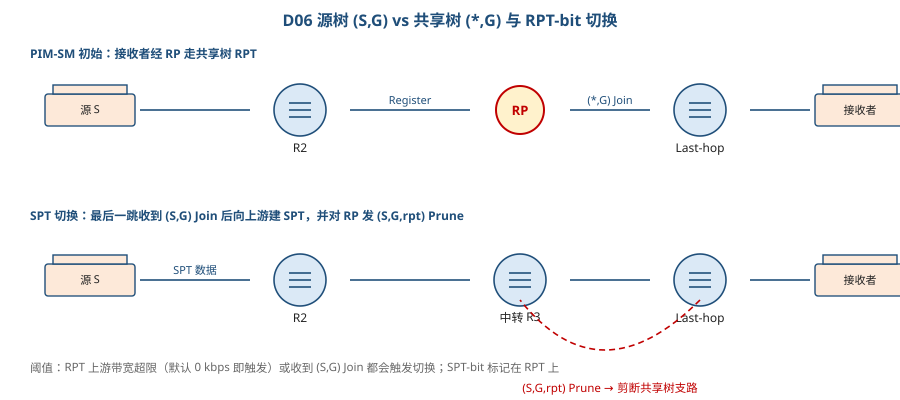
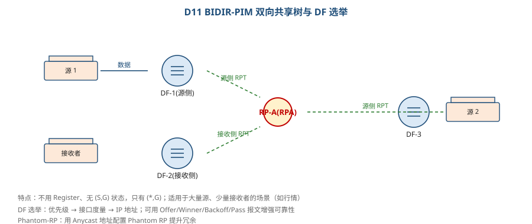

# 第 6 章 SSM 与 BIDIR-PIM：两个"砍掉 RP 复杂度"的方向

> 精读来源：**Aweya §5.17–5.18（p.342–345，SSM 的六条覆盖规则与 SSM-only 路由器要求）、§1.2.3（p.20–21，BIDIR-PIM 与 PIM-SM 的五点区别）**；BIDIR 的 DF 细节参考 RFC 5015
> 本章解决的问题：PIM-SM 的三条开销（注册隧道、RPT 低效、SPT 状态爆炸）分别对应两个"减法方案"——**SSM 砍掉 RP，BIDIR 砍掉 (S,G)**。

> ⚠️ 说明：Williamson 1999 年版成书早于 SSM 标准化，**本章不引用该书**；SSM 部分以 Aweya §5.17–5.18 为主，BIDIR 部分以 Aweya §1.2.3 的对比结论 + RFC 5015 为主。

## 学习目标

1. 说清 SSM 的"六条覆盖规则"分别否决了 PIM-SM 的哪个动作；
2. 判断一台路由器在 SSM 场景下**哪些状态机必须有、哪些必须没有**（SSM-only 路由器的取舍清单）；
3. 解释 BIDIR-PIM 为什么"没有 `(S,G)`、没有 DR、没有 Register"，以及代价；
4. 说清 DF（Designated Forwarder）的作用：它替代 DR 解决**双向共享树上的环路与重复**；
5. 在现网区分"SSM 组被当成 ASM 处理"与"BIDIR 组被当成 SM 处理"两类错配；
6. 面对 `show ip mroute` 里只有 `(*,G)` 没有 `(S,G)` 时，能立即想到"这是 BIDIR 或 SSM 模式问题，不是故障"。

---

## 1. SSM：把"谁是源"写进请求里

### 1.1 服务模型的改变

| 模型 | 接收者表达 | 需要的控制面 |
|---|---|---|
| ASM（PIM-SM/DM） | "我要 G" | RP、RPT、注册、SPT 切换 |
| SSM | "我要来自 S 的 G"（channel） | 只有 SPT，无 RP、无注册、无 `(*,G)` |

SSM 地址范围（RFC 4607，Aweya p.342–343）：

- IPv4：**232.0.0.0/8**
- IPv6：**FF3x::/32**（x 为 scope 标识）

Aweya p.344 对 "channel" 的定义值得记：一个 `(S,G)` 就是一个 channel；同一组可以有多个源，也就是多个 channel——**接收者订阅的是 channel，不是组**。所以组播电视这类"一组一源"的业务最贴合 SSM。



### 1.2 六条覆盖规则（原文照录）

Aweya p.342 明确：当目的地址落在 SSM 范围时，以下规则**覆盖 PIM-SM 的正常行为**：

| # | 规则 | 否决了什么 |
|---|---|---|
| 1 | **不得**发送 `(*,G)` Join/Prune | 共享树 |
| 2 | **不得**发送 `(S,G,rpt)` Join/Prune | SPT 切换的剪枝流程 |
| 3 | **不得**为 SSM 地址发送 Register | 注册隧道 |
| 4 | **不得**基于 `(*,G)`/`(S,G,rpt)` 状态转发；这些状态函数对 SSM 地址为 NULL | 共享树转发 |
| 5 | RP **不得**转发 SSM 地址的 Register，且**应当**回 `Register-Stop` | 兼容老设备 |
| 6 | **可以**不建 `(S,G,rpt)` 与 `(*,G)` 状态（优化） | 状态数量 |

规则 4–6 的用意在原文里写得很直白：**用来对付"SSM-unaware 的老路由器"**——它们可能仍然发 `(*,G)`、`(S,G,rpt)` 或 SSM 地址的 Register，新设备必须能容忍并纠正。

> 这条是混合现网的关键：**SSM 的健壮性不来自"大家都升级了"，而来自"新设备会拒绝老设备的错误动作"**。所以排障时看到老设备在发 `(*,G)`，不是配置错，而是要被抑制的对象。

### 1.3 SSM-only 路由器的取舍清单

Aweya p.342–343 给了两份清单，很适合当"设备能力评估表"：

**必须有**

- Hello / 邻居发现 / DR 选举
- 下游 `(S,G)` 状态机
- 上游 `(S,G)` 状态机
- `(S,G)` Assert 状态机
- 组播转发规则

**可以没有**

- Register 状态机
- BSR 选举
- `(*,G)` 与 `(S,G,rpt)` 的下游/上游状态机
- `(*,G)` Assert 状态机
- Keepalive 定时器
- SPTbit

原文还给了一句实现约定：SSM-only 路由器应把 **Keepalive 定时器视为永远运行、SPTbit 视为永远置位**。这解释了为什么在纯 SSM 网络里 `show ip mroute` 的 `(S,G)` 条目看不到 `T` 标志的翻转——**没有 RPT 可剪**。

### 1.4 主机侧：为什么必须 IGMPv3 / MLDv2

Aweya p.343：IGMPv3 与 MLDv2 提供**源过滤**能力，这是 SSM 的前提。IGMPv1/v2 只能表达"我要 G"，无法表达"我要 S 的 G"。

现网常见做法（厂商实现，非协议规定）：对 IGMPv2 主机做 **SSM Mapping**（静态或 DNS），把 "G" 映射成 "S 的 G"。代价是**映射表就是新的单点**，且无法表达多源。

```bash
show ip igmp groups 232.1.1.1 detail     # 看版本与源过滤
show ip igmp ssm-mapping 232.1.1.1       # 映射是否命中
show ip pim ssm                          # SSM 范围定义（default / acl）
```

---

## 2. BIDIR-PIM：把共享树变成双向的

### 2.1 五点区别（Aweya p.20–21）

| 维度 | PIM-SM | BIDIR-PIM |
|---|---|---|
| SPT | 会切换 | **不切，永不建 `(S,G)`** |
| 段上的 DR | 需要 | **不需要** |
| Register | 需要 | **不需要** |
| 转发规则 | 数据驱动事件多 | **无数据驱动事件，规则更简单** |
| SSM | 支持 | **不支持** |

原文对 BIDIR 的定义是：**流量沿一条以 RP 为根的双向共享树流动，树上的每条分支都可以双向传输**。源把流量朝 RP 方向送，接收者从 RP 方向收——两者共用同一棵树，因此不需要注册、也不需要切换。

### 2.2 DF：BIDIR 的核心机制

Aweya p.21 明确：**为防止 BIDIR-PIM 的转发环路，针对每个 RP，每条链路上选举一台路由器作为该链路的 Designated Forwarder（DF）**，选举通过 **DF Election 报文**在 RP 发现阶段完成。

用一句话概括 DF 与 DR 的区别：

- **DR 决定"谁替这段链路发/收组播"**，是**每段一个**，与 RP 无关；
- **DF 决定"谁在这段链路上朝 RP 转发上行的源流量"**，是**每 RP、每链路一个**，且**双向生效**。

RFC 5015 的选举依据（Aweya 未展开，此处按标准补）：比较到 RP 的 **Metric Preference（管理距离）→ Metric → IP 地址（大者胜）**。工程含义与 PIM 的 DR 选举、RPF 选路完全同源——**路由一变，DF 就换人**，所以"IGP 收敛慢"在 BIDIR 里直接表现为"流量短暂黑洞"，而不是"切换略慢"。

```
        [RP 10.255.0.1]
              |
        ┌─────┴─────┐
      R1            R2        ← 同段两台，只有一台是 DF
        │             │
      [SW]────────────┘
        │
      R3（非 DF：上行流量丢弃，只接收下行）
```



### 2.3 代价：为什么 BIDIR 不能滥用

Aweya p.21 同时给了收益与代价，这段要背：

- **收益**：每个组有大量源时扩展性好（只有 `(*,G)`，没有 `(S,G)` 爆炸）；
- **代价**：**没有 SPT，流量被强制走在相对低效的共享树上**（可能绕行 RP）。

判断准则：

| 场景 | 选择 |
|---|---|
| 一组一源、源固定 | SSM |
| 一组多源、源极多且动态 | BIDIR |
| 一组多源、但需要最优路径 | PIM-SM（接受状态开销） |

### 2.4 混合模式的一个硬约束

Aweya p.21 写得很清楚：三种模式可以在一个域内共存，**Hello 只跑一次，信息三方共享**，但——

> **同一个组不能同时工作在两种 PIM 模式**。

组范围必须**手工划分**。这就是"某几个组莫名不通"的一大来源：**同一组在两台路由器上落在了不同的模式范围里**。

---

## 3. 八个工程案例

> 以下为**典型化场景**，用于训练推理路径，不是具体故障的取证记录。

### 案例 1：应用按 SSM 设计，但主机只能发 IGMPv2

- **现象**：接收端加入 232.1.1.1 无流量；`show ip igmp groups` 显示 V2，且无源过滤信息。
- **定位**：`show ip igmp groups 232.1.1.1 detail`、`show ip igmp ssm-mapping`、抓包看 Report 版本。
- **根因**：IGMPv2 无法表达源，路由器把 `(S,G)` 请求退化成 `(*,G)`，在 SSM 范围内被规则 1 拒绝。
- **处置**：升级主机/应用至 IGMPv3；或配置 SSM Mapping 兜底。
- **复盘**：**SSM 是端到端能力**，中间设备再正确，主机不支持就是不通。

### 案例 2：SSM 范围未定义，232 组出现 `(*,G)`

- **现象**：`show ip mroute 232.1.1.1` 出现 `(*,G)`；RP 上出现该组的注册。
- **定位**：`show ip pim ssm`、`show ip pim rp mapping`（是否把 232 纳入了 RP 范围）。
- **根因**：未配置 `ip pim ssm default`（或有 ACL 漏掉该段），路由器按 ASM 处理 232/8。
- **处置**：定义 SSM 范围；同时确认 RP 的组范围 ACL **不包含** SSM 段。
- **复盘**：**SSM 与 RP 范围的边界要显式互斥**，靠默认行为很容易踩进来。

### 案例 3：双源热备，切换时接收端断 3 秒

- **现象**：主源停发后备用源接管，接收端中断约 3 秒。
- **定位**：两端 `show ip mroute` 的 `(S,G)` 是否存在、`show ip igmp groups detail` 是否同时含两个源。
- **根因**：接收端只 join 了主源 channel，源切换等于换 channel，需要重新 Join 建树。
- **处置**：应用侧同时加入两个 channel（INCLUDE 双源）；或缩短 Keepalive 依赖。
- **复盘**：**SSM 的"源固定"是语义层面的**——换源就是换服务，别指望路由层无缝。

### 案例 4：SSM 组被老设备注册到 RP，RP 转发造成双份

- **现象**：SSM 组在接收端偶发重复包；RP 上能看到该组的 Register。
- **定位**：RP 上 `show ip mroute 232.x`、`debug ip pim 232.x`（Register / Register-Stop）。
- **根因**：SSM-unaware 的首跳 DR 仍封装注册；RP 未按规则 5 回 `Register-Stop`（或实现不合规）。
- **处置**：升级首跳设备或规范 RP 行为；在 RP 上对 232/8 做过滤。
- **复盘**：**规则 5 是防火墙式的兼容措施**，缺了它，SSM 网络会被老设备"污染"。

### 案例 5：BIDIR 组配成了 PIM-SM

- **现象**：本应"多源少收"的行情组，RP 上出现海量 `(S,G)`；CPU 与内存上涨；部分源收不到。
- **定位**：`show ip mroute`（是否出现 `(S,G)`）、`show ip pim rp mapping`、两台边界路由器的模式配置。
- **根因**：组范围划到了 SM，每源都触发注册与状态建立。
- **处置**：把该组范围划入 BIDIR；确认全网一致。
- **复盘**：**"源特别多的组"出现 `(S,G)` 数量爆炸，先怀疑模式划错**，而不是先怀疑攻击。

### 案例 6：BIDIR 出现双 DF，接收端收到重复包

- **现象**：同一段上抓包看到同一组播包出现两次；`show ip pim df` 两侧都显示自己是 Winner。
- **定位**：`show ip pim df`（各 RP 的 DF 状态）、`show ip rpf <RP>`（两侧到 RP 的 metric）。
- **根因**：两侧到 RP 的 metric 计算不一致（如静态路由与 IGP 混用），选举结果各自认为胜出。
- **处置**：统一到 RP 的 metric 来源；清理静态路由。
- **复盘**：**DF 是"每 RP 每链路"的选举**，多 RP 场景下必须逐 RP 检查，别只看一个。

### 案例 7：BIDIR 组排障时找不到源，误判"源没发"

- **现象**：`show ip mroute 239.2.2.2` 只有 `(*,G)`，无 `(S,G)`；运维据此判断源未发送。
- **定位**：`show ip mroute 239.2.2.2`（看 `B` 标志）、RP 侧计数器、源端 `show ip mroute` 发送计数。
- **根因**：BIDIR 本来就不建 `(S,G)`，用 SM 的判据看 BIDIR 必然误判。
- **处置**：改用 `show ip mroute count` 与接口计数器判断流量。
- **复盘**：**先确认组的 PIM 模式，再选判据**；`B` 标志（Bidir Group）就是提示。

### 案例 8：混合模式同组跨模式，部分区域不通

- **现象**：同一组在 A 区正常、B 区不通；两侧配置看起来都"有"。
- **定位**：比对两侧 `show ip pim rp mapping` 与组范围 ACL；`show running-config | include pim`.
- **根因**：该组在 A 区落在 SM 范围、B 区落在 BIDIR 范围，两种模式无法互操作同一组。
- **处置**：统一组范围划分，按业务分段（SSM / BIDIR / ASM 各占独立地址块）。
- **复盘**：**地址规划决定模式边界**；把模式当"每台设备的偏好"是根本性误解。

---

## 4. 十问自测

1. SSM 的 IPv4 / IPv6 地址范围分别是什么？
2. SSM 六条规则里，哪三条是用来对付老设备的？
3. SSM-only 路由器不需要哪两个状态机？它对 Keepalive 与 SPTbit 如何处理？
4. 为什么 SSM 必须 IGMPv3 或 MLDv2？
5. SSM Mapping 的作用与代价？
6. BIDIR 与 SM 的五点区别？
7. DF 与 DR 的差别是什么？选举依据是什么？
8. BIDIR 为什么"没有数据驱动事件"？
9. 同一个组能否同时处于两种 PIM 模式？
10. 一组多源时，什么情况下该选 BIDIR 而不是 SM？

---

## 5. 原文精读索引

> 纸面页码：Aweya = PDF 页 − 21（经 `tools/srcgrep.py` 与页首页码实测核对）。

| 知识点 | 书/节 | 纸面页 | 原文可核对要点 |
|---|---|---|---|
| BIDIR 与 SM 的五点区别 | Aweya §1.2.3 | p.20–21 | 不切 SPT、不建 `(S,G)`、不支持 SSM；不需要 DR；不需要 Register；无数据驱动事件 |
| **DF 的作用与选举** | Aweya §1.2.3 | p.21 | “for each RP, a single router on each link is elected as the DF … using the DF Election messages” |
| BIDIR 的收益与代价 | Aweya §1.2.3 | p.21 | 多源扩展性好；但流量被迫走共享树 |
| 混合模式约束 | Aweya §1.2.4 | p.21 | 同一组不能同时处于两种模式；Hello 只跑一次 |
| SSM 地址范围 | Aweya §5.17 | p.342 | 232.0.0.0/8、FF3x::/32 |
| **SSM 六条覆盖规则** | Aweya §5.17.1 | p.342 | 不得发 `(*,G)`/`(S,G,rpt)`/Register；RP 应回 Register-Stop |
| SSM-only 路由器清单 | Aweya §5.17.2 | p.342–343 | 必需：Hello/DR、`(S,G)` 上下游、`(S,G)` Assert；无需：Register、BSR、`(*,G)` 状态机 |
| Keepalive 与 SPTbit 约定 | Aweya §5.17.2 | p.343 | 视 Keepalive 常运行、SPTbit 常置位 |
| SSM 服务模型与 channel | Aweya §5.18 | p.343–344 | 只用 SPT；无 RP/RPT/BSR/Auto-RP/MSDP；channel = `(S,G)` |
| IGMPv3 / MLDv2 的源过滤 | Aweya §5.18 | p.343 | SSM 依赖源过滤能力 |
| SPT 切换阈值（对比用） | Aweya §5.14 | p.288 | 速率阈值（kbps）触发，默认 0 即立刻 |

---

## 6. 延伸

- 标准：RFC 4607（SSM）、RFC 4604（IGMPv1/2 在 SSM 中的处理）、RFC 5015（BIDIR-PIM）、RFC 3810（MLDv2）
- 下一章：MSDP 与 MBGP——**域间**组播怎么把 RP 信息带过去
- 回顾：第 4 章 PIM-DM（"源多"的另一种解法）、第 5 章 PIM-SM（状态与切换的原始模型）
