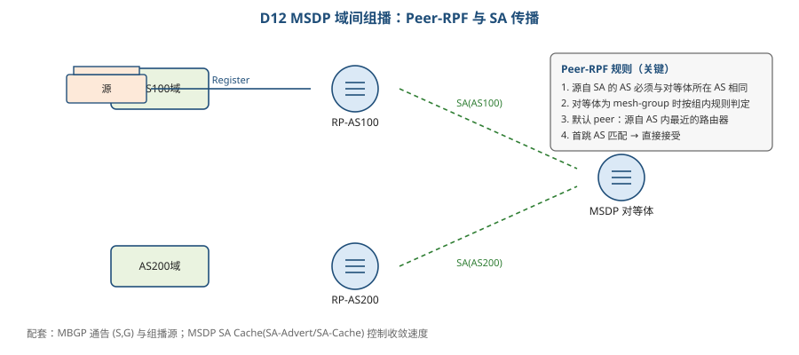

# 第 7 章 域间组播：MSDP 与 MBGP

> 精读来源：**Aweya Ch6（p.361–386：MSDP 概述 p.362–367、§6.5 peer-RPF p.372–374）、p.16 / p.40–42（MBGP 与 RPF 的关系）**
> 本章解决的问题：单域内 RP 是"配置出来的"，跨域时**对方的 RP 是谁、对方域里有哪些源**都必须靠协议交换。MSDP 交换"源在哪"，MBGP 交换"组播路径走哪"——**一个解决源发现问题，一个解决 RPF 问题**，经常被混为一谈。

## 学习目标

1. 分清 MSDP 与 MBGP 各自解决什么，为什么两个都需要；
2. 说清 SA 报文的三个关键字段（源、组、originator RP）与封装数据的规则；
3. 解释 peer-RPF flooding：**收到 SA 后凭什么判断该不该信**；
4. 说清 mesh-group 与 default peer 的适用场景与风险；
5. 把"域间能收到 SA 但拉不到流量"拆成 RPF、Join 路径、策略三段来查；
6. 知道 Anycast-RP 里 MSDP 的角色，以及 RFC 4610 出现后它的可替代性。

---

## 1. 跨域缺的是什么

| 缺的信息 | 谁提供 | 报文 |
|---|---|---|
| 我这个组有没有源、源在哪个域 | MSDP | Source-Active（SA） |
| 去往源/组的路径是否"组播可用" | MBGP | 带组播属性的 NLRI |
| 谁是我域的 RP | BSR / Auto-RP / 静态 | 域内机制，**不出域** |

关键认识：**RP 发现机制不出域**。BSR/Auto-RP 靠 224.0.1.40 泛洪，天然被域边界截断。所以跨域必须显式配 MSDP 对等体——这也是"域间组播一定要人工规划"的根本原因。

Aweya p.16 的措辞很直接：**MSDP 通常与 MBGP 一起用**（`MBGP/MSDP` 成对出现），因为源发现和 RPF 必须同时成立。

---

## 2. MSDP：把"源"告诉邻居域

### 2.1 会话建立

Aweya p.363 给了两个容易考到的细节：

1. **TCP 639**，不是 UDP；
2. **IP 地址高的一方监听（listen），低的一方主动发起连接**。

```
RP-A (10.1.1.1)  ←──── TCP 639 ────→  RP-B (10.2.2.2)
   低 IP 主动 connect            高 IP 被动 listen
```

所以"MSDP 邻居起不来"的第一件事是查 **639 是否双向放通**，第二件事是查**谁在 listen**（NAT/负载均衡后面很容易两边都不 listen）。

### 2.2 SA 报文

SA 携带：`(S, G)` 列表 + **originator RP 地址**（谁最先知道这个源），可选**封装第一个数据包**。

Aweya p.364 的两条格式约束很实用：

- 一个 SA 里多个 `(S,G)` 条目时，**只有最后一条可以带封装数据**；
- 带封装数据时，`Entry Count` 通常为 **1**。

为什么要封装首包？为了让接收域 RP 能**立刻**拿到数据、不必等源重新发包——对"发一次就停"的推送类业务很关键。

### 2.3 peer-RPF：凭什么信这条 SA

Aweya p.366、p.372–374：RP 收到 SA 后要判断"这条 SA 是否来自通往 originator RP 的正确方向"，这就是 **peer-RPF flooding**。

判断顺序（与单播 RPF 同构，但对象是"peer"）：

1. SA 的 originator 是**我自己** → 直接接受（本地源）；
2. originator 与我**在同一个 mesh-group** → 接受；
3. 到 originator 的 BGP/MBGP 下一跳 **就是发 SA 的这个 peer** → 接受；
4. 到 originator 的路由是**默认路由**，且该 peer 是 default peer → 接受；
5. 否则丢弃。

> 这条机制解释了"多出口域间"的经典故障：**去往对方 RP 的最优路由走了 A 出口，SA 却从 B 出口进来**——peer-RPF 失败，SA 被丢弃，表现为"邻居 up、`show ip msdp sa-cache` 却空"。

### 2.4 mesh-group 与 default peer

- **mesh-group**：全互联的一组 RP。成员之间**不互相转发 SA**（Aweya p.367、p.374），从一个成员收到的 SA 不再发给其他成员，避免 n² 重复；
- **default peer**：把"没有更具体路由的 SA"都交给某个 peer 处理，用于单出口的简单拓扑。

风险：mesh-group 配错（漏了某台）→ SA 在成员间来回；default peer 配错 → SA 从错误出口进来，被 peer-RPF 丢掉。



---

## 3. MBGP：让 RPF 走"组播路径"

### 3.1 与单播 BGP 的关系

MBGP（RFC 4760 的多协议扩展）在同一条 BGP 会话里同时承载 IPv4 单播与 IPv4 组播 NLRI。它可以：

- 宣告**和单播不同的组播拓扑**（同一前缀，两条不同 next-hop）；
- 让 RPF 检查优先使用组播路由。

Aweya p.40–42 明确了 RPF 的查表顺序：**静态 mroute → MBGP → 单播 RIB → 默认路由**，并强调"搜索 MBGP 或单播表时按最长前缀匹配；前缀长度与 metric 相同时再比较"。

> 与第 3 章的四级回退链对照看：**MBGP 排第二**。这解释了一个高频现象——路由表里明明有更具体的单播路由，RPF 却选了 MBGP 的路由，因为**优先级在"表"这一层就已经决定，不是最长前缀优先**。

### 3.2 典型跨域拓扑

```
        AS 100 (源域)                 AS 200 (接收域)
   S ── DR ── RP-A ═══ MBGP ═══ RP-B ── 最后一跳 DR ── 接收者
              ║  MSDP (SA: S,G)  ║
```

流程：

1. 源域 RP-A 收到 Register，建 `(S,G)`，向 MSDP peer **RP-B** 发 SA；
2. RP-B 通过 peer-RPF 接受，写入 SA cache；
3. 接收域主机加入 → 最后一跳 Join `(*,G)` 到 RP-B；
4. RP-B 发现 SA cache 里有 `(S,G)`，且自己是该组的 RP → 向源发 `(S,G)` Join（跨域，沿 MBGP 路径）；
5. 数据沿 SPT 到达 RP-B，再沿 RPT 下到接收者。

**注意第 4 步**：跨域时"RP 主动去拉源"是 MSDP 生态的核心动作，与"最后一跳切 SPT"是两件事。

---

## 4. 八个工程案例

> 典型化场景，用于训练推理路径，非具体故障取证。

### 案例 1：MSDP 邻居长期 `IDLE`/反复 up-down

- **现象**：`show ip msdp peer` 一直 `Down` 或 `Connect`，TCP 无 ESTABLISHED。
- **定位**：`show ip msdp peer`、`telnet <peer> 639`、边界 ACL 计数。
- **根因**：TCP 639 被 ACL 拦截；或两侧都配了 `connect-source` 指向不可达地址。
- **处置**：放通 639 双向；固定 loopback 作为 connect-source。
- **复盘**：**MSDP 是 TCP 应用**，任何"只放 UDP 组播"的 ACL 都会顺手打断它。

### 案例 2：邻居 up、SA 收到但 `sa-cache` 为空

- **现象**：`show ip msdp peer` 显示 Established 且有收发计数；`show ip msdp sa-cache` 为空。
- **定位**：`debug ip msdp`、`show ip bgp <originator-IP>`、`show ip rpf <originator-IP>`。
- **根因**：peer-RPF 失败——去往 originator RP 的路由下一跳不是这个 peer（多出口非对称）。
- **处置**：调整 MBGP 出口策略，或在接收侧配置正确的 default peer；必要时用 SA filter 显式放行。
- **复盘**：**"SA 有计数但没进缓存"= peer-RPF 丢的**，与链路质量无关。

### 案例 3：mesh-group 漏配，SA 在 RP 之间打转

- **现象**：多台 RP 全互联，CPU 偏高，`debug ip msdp` 看到同一 SA 反复进出。
- **定位**：逐台 `show ip msdp peer`（是否 mesh-group 成员一致）、`show ip msdp summary`。
- **根因**：mesh-group 成员清单不一致，某台把 SA 又发回成员。
- **处置**：统一 mesh-group 配置；或用 `ip msdp mesh-group <name> <member>` 全量补齐。
- **复盘**：**mesh-group 的价值是"抑制成员间转发"**，漏一台就等于没配。

### 案例 4：Anycast-RP 内 MSDP 全互联后 SA 风暴

- **现象**：4 台 Anycast RP 全互联，`sa-cache` 条目数远超实际源数，CPU 高。
- **定位**：`show ip msdp sa-cache summary`、`show ip msdp peer`。
- **根因**：两两互联形成完全图，SA 反复转发（缺 mesh-group 或 RFC 4610 机制）。
- **处置**：改为 mesh-group 或直接用 **PIM Anycast-RP（RFC 4610）**，不再用 MSDP 同步。
- **复盘**：**Anycast 内部的 MSDP 是"实现手段"，不是协议要求**（见第 5 章 p.331–332）。

### 案例 5：跨域 `(S,G)` 建不起来，RPF 指向错误出口

- **现象**：RP-B 上有 SA、有 `(*,G)`，就是没有 `(S,G)`；`show ip rpf <S>` 指向默认路由出口。
- **定位**：`show ip rpf <S>`、`show ip bgp <S>`、`show ip mbgp`（或在 BGP 中查看组播 NLRI）。
- **根因**：源前缀未通过 MBGP 宣告，RPF 回退到默认路由，Join 发往错误方向。
- **处置**：在源域出口宣告该前缀的组播 NLRI；核对 RPF 优先级。
- **复盘**：**"有 SA 无 `(S,G)`" 几乎等价于 RPF 失败**，先看 `show ip rpf`。

### 案例 6：新接收者加入后要等 1 分钟才有流

- **现象**：跨域组播，第一个接收者加入后约 60 s 才出流；后续正常。
- **定位**：RP-B 的 `show ip msdp sa-cache <G>` 时间戳、SA 的周期性刷新。
- **根因**：SA 缓存刚过期，需等下一次 SA 刷新；或源域只在注册时发一次 SA。
- **处置**：源域定期刷新 SA（周期性），接收域适当延长 SA cache 超时。
- **复盘**：**SA 是有寿命的"通告"**，不是永久状态；超时设置要与业务启动时延匹配。

### 案例 7：双出口域间，SA 从错误 peer 到达被丢弃

- **现象**：同一 SA 从 A 出口能进、从 B 出口进不来；现象随 IGP/BGP 收敛漂移。
- **定位**：`show ip msdp peer` 两个 peer 的计数、`show ip bgp` 到 originator 的 best path。
- **根因**：去往 originator 的最优路径与 SA 实际来向不一致。
- **处置**：用 mesh-group 把两出口纳入同一组，或统一出口选路。
- **复盘**：**peer-RPF 与单播选路强耦合**——单播一动，组播的 SA 接受关系就变。

### 案例 8：SSM 段出现 SA，跨域出现不该有的状态

- **现象**：`show ip msdp sa-cache` 里有 232/8 条目；接收域 RP 上出现该组注册。
- **定位**：`show ip msdp sa-cache | include 232.`、源域 RP 配置。
- **根因**：源域未把 232/8 划为 SSM，走了 ASM + 注册 → SA 跨域传播。
- **处置**：源域定义 SSM 范围；接收域对 232/8 做 SA 过滤。
- **复盘**：**SSM 的正确性依赖全域地址规划**，跨域时只要一端漏了，另一端就会被污染。

---

## 5. 十问自测

1. MSDP 与 MBGP 分别解决什么问题？
2. SA 报文里的 originator RP 是什么含义？
3. peer-RPF 的接受条件有哪几条？
4. mesh-group 抑制的是什么转发？
5. 为什么 RP 发现机制"不出域"？
6. MSDP 用 TCP 还是 UDP？端口？谁 listen？
7. RPF 查表顺序里 MBGP 排第几？
8. "有 SA、无 `(S,G)`"最先查什么？
9. Anycast-RP 内不用 MSDP 的替代方案是什么？
10. 跨域组播里"RP 主动拉源"与"最后一跳切 SPT"分别由谁触发？

---

## 6. 原文精读索引

> 纸面页码：Aweya = PDF 页 − 21（`tools/srcgrep.py` + 页首页码实测）。

| 知识点 | 书/节 | 纸面页 | 原文可核对要点 |
|---|---|---|---|
| MSDP 与 MBGP 成对使用 | Aweya §1.1 | p.16 | “MSDP is typically used with MBGP” |
| MSDP 用途（域间 / Anycast） | Aweya Ch6 引言 | p.362 | 域间交换 SA；Anycast-RP 内同步 |
| TCP 639 与 listen 规则 | Aweya §6.x | p.363 | 高 IP 侧 listen，低 IP 侧主动 connect |
| SA 封装数据规则 | Aweya §6.x | p.364 | 多条目时只有最后一条可带数据；Entry Count 通常为 1 |
| peer-RPF flooding | Aweya §6.5 | p.366、372–374 | 按 originator 的 peer-RPF 方向接受 SA |
| mesh-group 不互转 | Aweya §6.x | p.367、374 | 同组成员之间不再转发 SA |
| MBGP 与 RPF 优先级 | Aweya §1.x | p.40–42 | 静态 → MBGP → 单播 → 默认；同前缀比 metric |
| Anycast-RP 不需要 MSDP | Aweya §5.16.5 | p.331–332 | RFC 4610 的 PIM Anycast-RP 机制 |
| MSDP 的完整机制与配置 | W Ch17 | p.391、509–515 | SA/RPF 规则、mesh-group、默认 peer |

---

## 7. 延伸

- 标准：RFC 3618（MSDP）、RFC 4760（MP-BGP）、RFC 4610（Anycast-RP）
- 下一章：MVPN 与 MLDP——把组播搬进 MPLS/运营商骨干
- 回顾：第 3 章 RPF 四级回退链、第 5 章 RP 发现、第 6 章 SSM（跨域也要守 SSM 规则）
