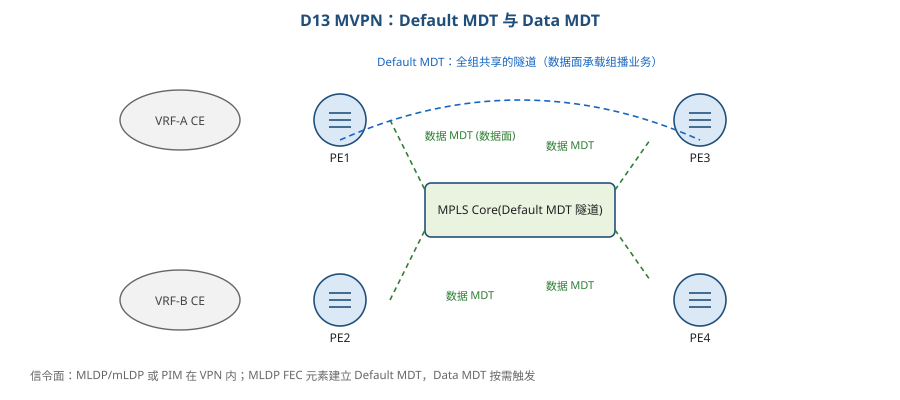

# 第 8 章 MVPN 与 MLDP：把组播搬进运营商骨干

> 精读来源：**Volume II Ch2（p.118–120：隧道 overlay 承载组播、DMVPN 的 hub 复制与容量测算、用静态 mroute / MBGP 做 RPF 分流）**、Aweya p.40–42（RPF 顺序）
> 说明：**四本原书均未系统覆盖 NG MVPN 与 mLDP**（Volume II 只讲到 GRE/DMVPN 这类 overlay）。因此本章的 mVPN/mLDP 细节以 **RFC 6513 / RFC 6514 / RFC 6388** 为准，凡未标注页码处均属标准与工程经验，不是原书摘录——**这一章的"原文可核对"比例最低，请以标准文本复核**。

## 学习目标

1. 说清 SP 骨干为什么不愿为每个客户跑 PIM；
2. 分清 **P-tunnel（数据面复制）** 与 **mVPN 控制面（谁要这份流）** 两层；
3. 解释 mLDP 的 in-band 信令：FEC 里装的是 `(RD, C-S, C-G)`；
4. 说清 mVPN 中 RPF 为什么"看 BGP 而不看 IGP"；
5. 把"P-tunnel 通了但客户收不到"拆成三层来查；
6. 用 DMVPN 的复制容量公式做一次骨干带宽估算（原文 p.118 的例子）。

---

## 1. 问题：骨干不能按客户跑 PIM

运营商骨干的现实约束：

| 约束 | 后果 |
|---|---|
| 客户数量多，每客户一套 RP/组地址 | PIM 状态按客户×组×源 爆炸 |
| 客户地址重叠（10.0.0.0/8 复用） | 骨干无法用 `(S,G)` 区分 |
| 骨干要独立于客户控制面演进 | 不能让客户改 IGP/BGP |

解法分两层：

- **数据面**：用一条 **P-tunnel**（点对多点隧道）在 PE 之间复制，骨干只看隧道标签，不看客户组地址；
- **控制面**：用 **BGP MCAST-VPN** 传递"哪个 PE 要哪个 `(C-S,C-G)`"。

---

## 2. 数据面：四种 P-tunnel

| 方案 | 信令 | 复制点 | 适用 |
|---|---|---|---|
| PIM-SM/GRE（Default MDT） | PIM | 每 PE 各自封装 | 传统 mVPN，最成熟 |
| PIM-SSM/GRE（Data MDT） | PIM | 同上，按流切换 | 大流量优化 |
| **mLDP（P2MP LSP）** | 无显式协议，in-band | 由 LSP 的 bud 节点复制 | 骨干原生 MPLS |
| RSVP-TE P2MP | RSVP-TE | LSP | 需要 TE/带宽预留 |

### 2.1 mLDP 的关键：FEC 里带客户信息

mLDP（RFC 6388）用 **FEC 元素** 标识一棵树，典型 FEC 是 **P2MP FEC**：

```
Root Node Address = PE（或 RP 所在 PE）
Opaque Value      = { VPN-ID / RD, C-S, C-G }
```

PE 想要某条客户流，就向 root 发 Label Mapping（in-band 信令）；中间 P 路由器只按 FEC 建状态、按 LSP 转发，**不需要组播路由协议**。中间节点若同时有下游与上游需求，就在本地复制（bud node）。

> 这解释了 mLDP 的一个排障特征：**没有"邻居 down"这种现象**。链路断了，Label Mapping 超时撤销，LSP 重建，业务闪断但**控制面无告警**——比 PIM 静默得多。

---

## 3. 控制面：BGP MCAST-VPN

mVPN 用 BGP 的 **MCAST-VPN 地址族（AFI 1 / SAFI 5）** 传递 7 类路由（RFC 6514）：

| 类型 | 名称 | 作用 |
|---|---|---|
| 1 | Intra-AS I-PMSI A-D | "我在这个 VRF 里提供服务" |
| 2 | Inter-AS I-PMSI A-D | 跨 AS |
| 3 | S-PMSI A-D | "这条流改用专用隧道" |
| 4 | Leaf A-D | "我要加入这棵 S-PMSI" |
| 5 | Source Active A-D | 源发现（替代部分 MSDP 角色） |
| 6/7 | C-Multicast Route（共享/源树 Join-Prune） | 客户的 `(*,C-G)` / `(C-S,C-G)` |

关键认识：**第 6/7 类就是"客户的 PIM Join"被翻译成 BGP**。所以 mVPN 里"客户侧 Join 到了 PE，但没到远端 PE"等价于"BGP 没把 C-Multicast Route 传过去"。



### 3.1 RPF：看 BGP，不看 IGP

mVPN 中 PE 判断"这个 `(C-S,C-G)` 该从哪个 PE 收"，依据是 **BGP 的 uMH（upstream multicast hop）或 S-PMSI A-D 的 originator**，而不是 IGP 到 C-S 的路径。

> 对照第 3 章：**普通域的 RPF 是"到源的单播路由"；mVPN 的 RPF 是"到源的 PE 的 BGP 路由"**。混用这两套判据是 mVPN 排障最常见的错。

---

## 4. 八个工程案例

> 典型化场景；本章案例多为 mVPN 通用故障模式，**不来自原书**。

### 案例 1：P-tunnel 正常，客户组播不通

- **现象**：`show mpls mldp database` 有 LSP；两端 PE 的 I-PMSI 正常；客户侧 `show ip mroute` 无 `(C-S,C-G)`。
- **定位**：`show bgp vpnv4 unicast` / `show bgp mvpn all`（查 route-type 6/7）、`show ip msdp sa-cache`（若用 SA）。
- **根因**：C-Multicast Route 未被通告（VRF 下未开 mVPN AFI、RR 未reflect）。
- **处置**：在 VRF 与 RR 上补齐 MCAST-VPN 地址族。
- **复盘**：**P-tunnel 是数据面，C-route 是控制面**，两层要分别验证。

### 案例 2：S-PMSI 切换造成带宽尖峰

- **现象**：某大流量组切入 S-PMSI 时，骨干链路 3–5 秒内出现两份流。
- **定位**：`show bgp mvpn all`（route-type 3/4）、PE 上 `show mdt`/`show mpls mldp database` 双份条目。
- **根因**：切换期间 I-PMSI 与 S-PMSI 并存（软切换）。
- **处置**：可接受（设计使然）；容量规划需为切换预留双份带宽。
- **复盘**：**mVPN 的"切换"与 PIM 的 SPT 切换同构**——都存在短暂双份。

### 案例 3：mLDP bud node 复制导致某条链路拥塞

- **现象**：P 路由器某接口出向流量是入向的 N 倍。
- **定位**：`show mpls mldp database detail`（bud 标记）、接口流量对比。
- **根因**：bud 节点承担复制，容量规划未计入。
- **处置**：调整 LSP 的 root 或使用多条 P2MP LSP 分摊。
- **复盘**：**mLDP 把复制点从"源"推到"树的分叉点"**，规划时要按分叉点算带宽，而不是按源算。

### 案例 4：改 RD 后 mLDP 业务闪断

- **现象**：VRF 调整 RD 后，该 VRF 的组播中断数十秒。
- **定位**：`show mpls mldp database`（FEC 已变）、`show bgp mvpn all`。
- **根因**：FEC 中的 VPN-ID 取自 RD，RD 变更 ⇒ 整棵 LSP 重建。
- **处置**：变更窗口内操作；避免在业务高峰改 RD。
- **复盘**：**RD 不只是"路由标识"，它进了数据面的 FEC**——这是 mVPN 特有的耦合。

### 案例 5：跨 AS 组播不通（Option B）

- **现象**：AS 内正常，跨 AS 无流；BGP 有路由但 P-tunnel 不连续。
- **定位**：两端 ASBR 的 mVPN 路由类型（是否用 Inter-AS I-PMSI A-D）、`show mpls forwarding` 标签连续性。
- **根因**：Option B 下 P-tunnel 需逐 AS 重建，某段未建。
- **处置**：统一 inter-AS 方案（B/C），核对 ASBR 的 mVPN 配置。
- **复盘**：**跨域组播的难点不在路由，在"隧道是否端到端连续"**。

### 案例 6：MTU 导致的"小包正常、大包丢"

- **现象**：ping 通、视频卡顿；PE 上看到分片/丢弃计数。
- **定位**：`ping <PE> size 1500 df-bit`、接口 MTU 与隧道开销核算。
- **根因**：GRE/VXLAN 封装增加 24–50 字节，路径 MTU 未调整。
- **处置**：调大核心 MTU 或调小客户侧 MSS/MTU。
- **复盘**：**任何 overlay 组播都要先算封装开销**。

### 案例 7：RR 未开 mVPN AFI，部分 PE 收不到路由

- **现象**：新上线的 PE 没有任何 mVPN 路由，其他 PE 正常。
- **定位**：`show bgp all summary`（MCAST-VPN 邻居是否为 `Act`）、RR 配置。
- **根因**：RR 的 MCAST-VPN 地址族未启用或未加该 PE 为客户端。
- **处置**：RR 上启用并向该 PE 反射。
- **复盘**：**mVPN 强依赖 RR**，新增节点的检查单里必须有"AFI 5 是否 Act"。

### 案例 8：DMVPN hub 复制能力不足（原文 p.118 的算式）

- **现象**：分支扩容到 100 个后，hub 出向 WAN 打满、丢包。
- **定位**：hub 出接口利用率、平台复制能力、`show ip mroute` 出接口数。
- **根因**：mGRE 中 **spoke-to-spoke 的组播也必须经 hub 复制**，`200 MB × 100 = 2 GB` 全部压在同一条出链路上。
- **处置**：多 tunnel headend 分担（原文 p.119 的做法）、区域 RP + 本地复制。
- **复盘**：**overlay 的"多播"往往退化成"单播复制"**，带宽要按"流大小 × 分支数"算，不是按流算。

---

## 5. 十问自测

1. P-tunnel 与 mVPN 控制面分别解决什么？
2. mLDP 的 FEC 里装了什么？为什么说它是 in-band 信令？
3. mVPN 的 RPF 依据是什么？为什么不看 IGP？
4. Route-type 6/7 对应客户侧的什么动作？
5. S-PMSI 切换为什么会短暂双份？
6. bud node 是什么？容量规划怎么算？
7. 为什么改 RD 会导致业务闪断？
8. Option B 跨 AS 的难点在哪？
9. GRE/VXLAN 封装对 MTU 的影响怎么算？
10. DMVPN 里 spoke-to-spoke 组播为什么要过 hub？

---

## 6. 原文精读索引

> 纸面页码：Volume II = PDF 页 − 18；Aweya = PDF 页 − 21。

| 知识点 | 书/节 | 纸面页 | 原文可核对要点 |
|---|---|---|---|
| 用静态 mroute / MBGP 分离组播与单播路径 | v2 Ch2 | p.118 | 等代价路径下强制组播走指定接口；BGP 组播地址族的 next-hop 需递归查 IGP |
| **隧道 overlay 承载组播** | v2 Ch2 | p.118 | “Multicast across point-to-point GRE tunnels is simple, and the only consideration is the RPF interface” |
| DMVPN 与 NHRP | v2 Ch2 | p.118 | spoke-to-spoke 直连**不适用于组播**，组播必须经 hub |
| **复制容量算式** | v2 Ch2 | p.118 | 100 spoke × 200 MB = 2 GB 出向带宽；平台需具备复制能力 |
| 多 headend 分担复制 | v2 Ch2 | p.119 | 按平台复制能力与分支数分摊到多个 tunnel headend |
| 区域 RP 设计 | v2 Ch2 | p.120 | 区域复制 + 全局组播衔接的分层设计 |
| RPF 查表顺序 | Aweya §1.x | p.40–42 | 静态 → MBGP → 单播 → 默认路由 |
| NG MVPN / mLDP 机制 | **无原书覆盖** | — | 见 RFC 6513/6514/6388，本章按标准整理 |

---

## 7. 延伸

- 标准：RFC 6513（mVPN 架构）、RFC 6514（BGP MCAST-VPN）、RFC 6388（mLDP）、RFC 7385（IGP 不承载 mVPN 的说明）
- 下一章：数据中心与云上组播（overlay 的另一种形态）
- 回顾：第 3 章 RPF、第 7 章 MSDP（mVPN 里 Source Active A-D 承担类似角色）
