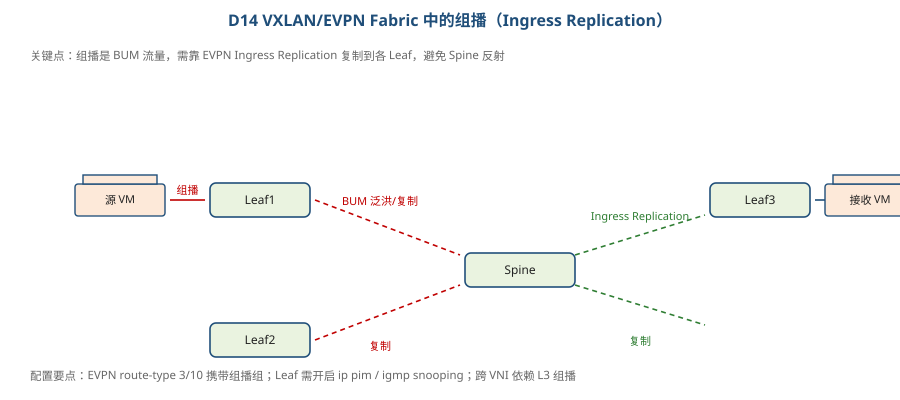

# 第 9 章 数据中心与云上组播

> 精读来源：**Volume II Ch2（p.99–100：公有云为何默认不提供原生组播、IaaS 与混合部署的定位；p.101–107：连接云的方式；p.118–120：隧道 overlay、hub 复制与区域 RP）、p.9 / p.60（`show ip mroute` 标志位含 `x - VxLAN group`）**
> 本章解决的问题：组播在两个"非传统园区"的环境里形态完全变了——**数据中心里组播是 underlay 的传输机制（VXLAN BUM）**，**公有云里组播默认不存在**。

## 学习目标

1. 说清公有云为什么不默认开组播（不是"忘了"，是**可扩展性与多租户成本**）；
2. 区分 VXLAN 的两种 BUM 复制方式，知道各自对 underlay 的要求；
3. 说清 vPC/MCLAG 双活网关下 PIM DR 与网关角色的错配如何造成黑洞；
4. 用"underlay / overlay / 应用"三层定位 DC 组播故障；
5. 知道云上组播的三条现实路径（隧道回本地、单播化、云商托管方案）；
6. 认识 `x - VxLAN group` 这个标志位，避免把 VXLAN 组播条目当成普通 `(S,G)`。

---

## 1. 公有云：为什么默认没有组播

Volume II p.99 的解释值得完整记住——**它把"限制"讲成了工程权衡**：

> 公有云环境目前不启用组播。原因是：向客户自有云段内的**每一台主机**发送组播包，会在数据面与控制面的**可扩展性**上对云 fabric 造成影响。随着客户在云上增加需要组播的资源，平台必须扩容并满足动态组播需求的其它约束；这类改动**代价高**，且**容量估算带有投机性**，会影响云消费者的体验。加入**多租户**后，变更估算更复杂：在云 fabric 内允许组播协议会影响 fabric 性能。

拆成三条：

| 原因 | 含义 |
|---|---|
| 数据面 | BUM 流量天然泛洪，云 fabric 靠 sparse 收敛，泛洪等于打回原形 |
| 控制面 | 组播状态随"租户 × 组 × 源"增长，云商无法为单租户预留 |
| 商业 | 无法定价、无法隔离故障域，"一个租户的组播风暴"可能伤及其他租户 |

p.100 同时给了出路：**IaaS 场景可以承载组播需求**，多数企业采用混合部署（Web 层上云、应用与数据库留在本地）。

### 1.1 云上组播的三条现实路径

| 路径 | 做法 | 代价 |
|---|---|---|
| 隧道回本地 | 云内实例与本地组播域用 GRE/IPsec 隧道打通，在本地做复制 | 云内无复制优势，回程带宽成为瓶颈 |
| 应用层单播化 | 应用改成"每个消费者一条单播流"或消息队列 | 失去组播的带宽优势，但最可控 |
| 云商托管组播 | 部分云商提供"托管组播/中转网关"类服务 | 绑定云商，跨云不可移植 |

p.101 的连接方式（直连专线 / 云代理）决定了**组播能否借道**：直连专线常同时承载单播与组播隧道，云代理模式则多一层 NAT/安全策略，**IGMP 与 PIM 往往在第一跳就被拦**。

---

## 2. 数据中心：组播是 underlay 的"隐形基础设施"

### 2.1 VXLAN 的 BUM 复制

| 方式 | underlay 要求 | 优点 | 缺点 |
|---|---|---|---|
| **组播复制**（传统 VXLAN） | underlay 必须跑 PIM-SM，有 RP | 复制由网络完成，VTEP 无状态 | 需要维护 RP/组播域；BUM 泛洪到所有 VTEP |
| **Ingress Replication**（EVPN） | 只需单播 | 无 RP、无组播依赖 | 源端复制，头部 CPU 压力大 |

选型后果很直接：**"云/DC 不需要组播"这句话只对 EVPN 成立；用组播复制的 VXLAN，组播是整个 fabric 的地基**。

Volume II p.9 与 p.60 列出的 `show ip mroute` 标志位里有 **`x - VxLAN group`**——说明在 NX-OS 上，VXLAN 的 underlay 组条目会和普通 `(S,G)` 混在同一张表里。排障时若不区分，很容易把"VTEP 的 BUM 组"当成"应用的组播组"。

```bash
show ip mroute 239.1.1.1 | include VxLAN    # 是否 VXLAN 承载
show nve peers                              # VTEP 邻居与复制方式
show ip pim rp mapping                      # underlay 的 RP 是否正确
```



### 2.2 双活网关的两个经典错配

| 错配 | 后果 |
|---|---|
| vPC 两台都成为 PIM DR | 双份流（若下游交换机未做抑制） |
| HSRP 活跃网关 ≠ PIM DR | 上游流量送到非活跃网关，**下行黑洞** |

根因是同一个：**HSRP/VRRP 的"活跃"与 PIM 的"DR"是两套独立选举**，判据不同（HSRP 看优先级与 IP，PIM DR 看 DR Priority 与 IP）。规范做法是让两者对齐——例如把 DR Priority 配在 HSRP Active 那台上，或在 vPC 场景固定 `dr-priority`。

---

## 3. 八个工程案例

> 典型化场景；DC/云部分多为现网常见故障模式，非原书案例。

### 案例 1：应用整体上云后组播不通

- **现象**：迁移到公有云后，原依赖组播的服务发现失效。
- **定位**：云内实例 `ip maddr`、云安全组/网络 ACL 规则、是否有到本地的隧道。
- **根因**：云 fabric 不提供原生组播（v2 p.99），实例的 IGMP/组播包被丢弃。
- **处置**：改为应用层单播/消息队列，或建隧道回本地组播域。
- **复盘**：**上云评估里必须有"是否依赖组播"这一项**，迁移后再补成本极高。

### 案例 2：VXLAN 用组播复制，跨 VTEP 同子网不通但单播正常

- **现象**：同 VNI 不同 VTEP 的虚拟机互 ping 不通；同 VTEP 内正常。
- **定位**：`show ip mroute`（BUM 组是否有 `(S,G)`）、`show ip pim neighbor`（VTEP 上联）、underlay RP 配置。
- **根因**：underlay 未启用 PIM 或 RP 不通，BUM 组无法跨 VTEP 复制。
- **处置**：补齐 underlay PIM-SM 与 RP；或改用 EVPN ingress replication。
- **复盘**：**VXLAN 组播复制的故障，症状全在 overlay，根因全在 underlay**。

### 案例 3：vPC 双活，接收端收到双份包

- **现象**：抓包看到同一组播包两次。
- **定位**：两台 leaf 的 `show ip pim interface`（是否都为 DR）、`show vpc`。
- **根因**：两台都当选 DR，各自向下游转发。
- **处置**：固定 `dr-priority`（一台高、一台 0）；下游开启 IGMP snooping 抑制。
- **复盘**：**vPC 场景默认行为不会自动选一个 DR**，必须显式配。

### 案例 4：HSRP 切主后组播断，单播正常

- **现象**：网关切换后，主机单播正常，组播不通。
- **定位**：`show standby brief` 与 `show ip pim interface` 对比两台角色。
- **根因**：HSRP Active 切到 B，但 PIM DR 仍是 A；A 没有下游接收者状态，流量到 A 被丢。
- **处置**：让 DR 与 HSRP Active 对齐（DR Priority 或 preempt 配合）。
- **复盘**：**"单播通、组播不通"在网关切换后出现，先比 HSRP 与 DR 的角色**。

### 案例 5：DC 内 Anycast RP 跨 leaf 注册失败

- **现象**：源挂在 leaf1、接收者在 leaf2，组不通；同 leaf 内正常。
- **定位**：两台 RP（anycast 地址）的 `show ip pim rp mapping`、MSDP 或 RFC 4610 配置。
- **根因**：Anycast RP 地址一致但注册信息未同步。
- **处置**：补 MSDP 或 `ip pim anycast-rp`（RFC 4610）。
- **复盘**：**Anycast 只解决"地址可达"，不解决"状态同步"**（同第 5 章案例 6）。

### 案例 6：虚拟化主机上组播泛洪到所有虚拟机

- **现象**：宿主机上行带宽异常，未订阅的虚拟机也收到组播包。
- **定位**：vSwitch 的 IGMP snooping 配置、`tcpdump` 在无关 VM 上验证。
- **根因**：vSwitch 未开 IGMP snooping，组播按广播泛洪。
- **处置**：开启 snooping 与 querier（或依赖上游 querier）。
- **复盘**：**组播的"免费复制"只在最后一跳有效**，最后一跳没 snooping 就等于广播。

### 案例 7：跨租户/跨 VRF 组播串流风险

- **现象**：安全审计发现 VRF-A 的组播流量出现在 VRF-B 的接口上。
- **定位**：`show ip mroute vrf`、VRF 间是否有组播路由泄漏（`ip multicast-routing vrf` + 边界配置）。
- **根因**：VRF 边界未做组播过滤，或共用同一 underlay 组。
- **处置**：按租户隔离 underlay 组与 RP；边界加 ACL。
- **复盘**：**组播的隔离比单播弱**——单播靠路由表天然隔离，组播要靠显式边界。

### 案例 8：云上安全组拦掉 IGMP/组播

- **现象**：隧道已建、路由正常，仍收不到组播。
- **定位**：云侧安全组/网络 ACL（是否只放行 TCP/UDP）、实例内 `tcpdump`。
- **根因**：云安全模型按"连接"放行，IGMP（IP 协议 2）与组播 UDP 无"连接"概念。
- **处置**：显式放行协议号 2 与所需 UDP 端口；必要时改用单播隧道端口。
- **复盘**：**云侧 ACL 是"五元组思维"，组播要被单独设计**。

---

## 4. 十问自测

1. 公有云默认不开组播的三个原因？
2. IaaS 与混合部署对组播的意义？
3. VXLAN BUM 的两种复制方式及对 underlay 的要求？
4. `x - VxLAN group` 标志说明什么？
5. vPC 双活为什么会双份？
6. HSRP Active 与 PIM DR 不一致会造成什么？
7. Anycast RP 在 DC 内为什么还需要状态同步？
8. vSwitch 不开 snooping 的后果？
9. 云安全组为什么容易拦掉组播？
10. 跨 VRF 组播隔离靠什么？

---

## 5. 原文精读索引

> 纸面页码：Volume II = PDF 页 − 18。

| 知识点 | 书/节 | 纸面页 | 原文可核对要点 |
|---|---|---|---|
| **公有云不启用原生组播的原因** | v2 Ch2 | p.99 | 向客户段内每台主机发包影响 fabric 可扩展性；多租户使估算更复杂；允许组播影响 fabric 性能 |
| IaaS 可承载组播、混合部署 | v2 Ch2 | p.100 | Web 层上云、应用与数据库留本地；多数 CSP 不支持组播 |
| 云的连接方式 | v2 Ch2 | p.101 | 直连专线 / 云代理两类接入 |
| 隧道 overlay 承载组播 | v2 Ch2 | p.118 | 点对点 GRE 简单，唯一考虑是 RPF 接口 |
| hub 复制与容量 | v2 Ch2 | p.118 | 200 MB × 100 spoke = 2 GB 出向 |
| 区域 RP 分层设计 | v2 Ch2 | p.120 | 区域复制 + 全局组播衔接 |
| `x - VxLAN group` 标志 | v2 Ch1/Ch2 | p.9、p.60 | `show ip mroute` 标志位释义中包含 VXLAN 组 |
| 园区网二层组播与 Snooping | W Ch14 | p.407–417 | VLAN 内组播被交换机如何学习与转发 |
| CGMP 的历史角色 | W Ch14 | p.427–430 | 思科私有方案，已被 IGMP Snooping 取代 |
| vPC 环境下的组播 | v2 Ch4 | p.207–211 | vPC 对组播复制与转发路径的影响 |
| VXLAN flood-and-learn 与 EVPN | v2 Ch4 | p.213–224 | VTEP、BUM 处理、EVPN 下的组播转发 |
| Ingress Replication 与主机间组播 | v2 Ch4 | p.224–227 | 用单播复制承载 VXLAN 组播 |
| ACI 的 Snooping 与三层组播 | v2 Ch4 | p.227–235 | ACI fabric 的二层 snooping / 三层组播实现 |

---

## 6. 延伸

- 标准/文档：RFC 7348（VXLAN）、RFC 7432（EVPN）、RFC 8365（EVPN 组播）
- 下一章：IPv6 组播（同一套 PIM，不同的地址与成员协议）
- 回顾：第 2 章 snooping（vSwitch 同理）、第 5 章 RP 发现（underlay 也要 RP）
