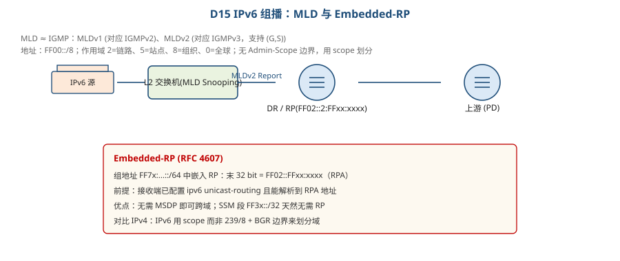

# 第 10 章 IPv6 组播：同一套树，另一套地址与成员协议

> 精读来源：**Aweya §1.3（p.5：FF02::1 与 link-local 作用域的实际用法）、p.8（`11111111` 前缀与 FF00::/8、Scope 字段的六种取值）、p.9（MLD 与 IGMP 的对应关系）、p.15（`FF02::D` 作为 All-PIM-Routers）、p.19（IGMPv3/MLDv2 的源过滤）**
> 本章解决的问题：IPv6 组播**没有引入新协议**——PIM 状态机、RPF、SPT 切换全部复用；变的是**地址结构、成员协议（MLD）、以及"组播依赖 ICMPv6"这一点**，而最后一点是现网最高频的坑。

## 学习目标

1. 拆开 IPv6 组播地址的 4 个字段，说出 Scope 六种取值；
2. 记住 5 个必背的知名组地址（含 `FF02::D`）；
3. 说清 MLDv1/v2 与 IGMPv2/v3 的对应关系，以及 MLDv2 为什么是 SSM 的前提；
4. 解释"MLD 走 ICMPv6"带来的 ACL 陷阱；
5. 说清 PIM over IPv6 为什么必须用 link-local 地址做邻居；
6. 在双栈环境下判断"v4 组播正常、v6 组播不通"该从哪开始查。

---

## 1. 地址结构：8 + 4 + 4 + 112

Aweya p.8：IPv6 组播地址以二进制前缀 **`11111111`**（即 **`FF00::/8`**）开头，随后是：

```
| 8 bit  | 4 bit  | 4 bit   | 112 bit        |
|11111111| flags  | scope   | group ID       |
   FF       0-F      1,2,5,8,E   任意
```

**Scope 字段**（p.8 列出的六种）：

| 值 | 名称 | 含义 |
|---|---|---|
| 1 | Interface-Local | 本接口（回环测试） |
| 2 | Link-Local | 本链路（**最常用**） |
| 5 | Site-Local | 站点内 |
| 8 | Organization-Local | 组织内 |
| E | Global | 全局 |

这个字段是 IPv4 完全没有的能力：**同一个组 ID 可以在不同 scope 下是"不同的组"**。所以"v6 组播不通"有一类根因是**作用域不匹配**——应用申请 `FF05::` 而路由器只转发 `FF0E::`，或者边界路由器按 scope 做了过滤。

### 1.1 五个必背地址

| 地址 | 用途 |
|---|---|
| `FF02::1` | All-Nodes（所有节点） |
| `FF02::2` | All-Routers |
| `FF02::5` / `FF02::A` | OSPFv3 / EIGRPv6 |
| **`FF02::D`** | **All-PIM-Routers**（对应 IPv4 的 224.0.0.13，Aweya p.15） |
| `FF02::1:FFxx:xxxx` | Solicited-Node（ND 用，非"应用组播"） |

Aweya p.5 有个细节值得记：**`FF02::1` 虽然存在，但目前没有 IPv6 协议真的向它发包**——节点各自加入所需的 link-local 组（如 NTP 用 `FF02::101`）。所以"抓到 FF02::1 就以为有协议在用"是误判。



---

## 2. MLD：IGMP 的 IPv6 版本

Aweya p.9 明确：**MLD（RFC 2710 / RFC 3810）与 IGMP 在组播成员管理上是对应关系**；p.19 进一步：IGMPv3 对应 IPv4、**MLDv2 对应 IPv6**，两者都提供"订阅 channel `(S,G)`"的能力。

| IPv4 | IPv6 | 能力 |
|---|---|---|
| IGMPv1 | — | 无 leave |
| IGMPv2 | MLDv1 | 有 leave（MLD Report/Done） |
| **IGMPv3** | **MLDv2** | **源过滤（SSM 前提）** |

### 2.1 最大的坑：MLD 跑在 ICMPv6 上

MLD 报文不是独立的传输层协议，而是 **ICMPv6 报文类型 130（Query）/ 131（Report）/ 132（Done）**。含义很直接：

> **任何"只放行 TCP/UDP"的 ACL，都会顺手掐死 MLD**；而 MLD 死了，组播成员关系就建不起来。

这条与第 2 章"接口 ACL 只放行 UDP 却拦了 IGMP"是同一类错误，但在 IPv6 里更隐蔽——因为很多人不知道 MLD 属于 ICMPv6。

```bash
show ipv6 mld groups                 # 成员表
show ipv6 mld interface              # querier 状态
show ipv6 mroute                     # (S,G) 与 (*,G)
show ipv6 pim neighbor               # PIM 邻居（link-local）
```

---

## 3. PIM over IPv6：复用状态机，换掉地址

- **邻居与报文**：PIM Hello 发往 `FF02::D`（Aweya p.15），逐跳用 **link-local 地址**做下一跳；
- **状态机完全一致**：`(*,G)`、`(S,G)`、`(S,G,rpt)`、Assert、Register、SPT 切换，一条不少；
- **RP 发现**：静态 / BSR / Anycast 均可用；嵌入式 RP（RFC 3956）在 v6 里用 `FF7x::/16` 编码 RP 地址，部署比 v4 常见；
- **SSM**：`FF3x::/32`（见第 6 章）。

> 工程含义：**IPv6 组播排障 ≠ 学一套新协议**，`show ipv6 mroute` 的 flags 读法与 v4 完全一样（`J`/`T`/`R`/`B`）。真正的新增只有两处：**地址 Scope 与 MLD（ICMPv6）**。

### 3.1 link-local 邻居的必要性

IPv6 的 PIM 邻居用 link-local 地址标识（`FE80::/10`）。这带来两个差异：

1. **配置 RPF/邻居时不能用全局地址"猜"**——一条链路上每台都可能是 `FE80::1`，必须绑定接口（`show ipv6 pim neighbor` 会带接口名）；
2. **ECMP 下 link-local 邻居无法唯一定位**，因此 v6 组播的多路径排障比 v4 更容易"看不出来"。

---

## 4. 八个工程案例

> 典型化场景，用于训练推理路径。

### 案例 1：v4 组播正常，v6 组播完全不通

- **现象**：同一套 PIM 配置，`show ip mroute` 有状态，`show ipv6 mroute` 为空。
- **定位**：`show ipv6 pim neighbor`、`show ipv6 mld interface`、接口是否启用 `ipv6 pim`。
- **根因**：只开了 `ip multicast-routing`，未开 `ipv6 multicast-routing`；或接口漏配 `ipv6 pim`。
- **处置**：补齐 v6 组播路由与接口 PIM。
- **复盘**：**双栈不是"开一个就都有"**，v4/v6 的组播是两套独立进程。

### 案例 2：ACL 放行了 UDP，但 MLD 被拦

- **现象**：主机加入组失败；`show ipv6 mld groups` 无条目。
- **定位**：接口 ACL 命中计数、抓包看 ICMPv6 类型 130/131/132。
- **根因**：ACL 只放行 TCP/UDP，MLD（ICMPv6）被丢。
- **处置**：放行 ICMPv6 MLD 类型（含 ND 所需类型）。
- **复盘**：**IPv6 里"组播"和"ICMPv6"是绑在一起的**，安全策略要成组考虑。

### 案例 3：应用使用 FF05::，跨域不通

- **现象**：站点内正常，跨站点不通。
- **定位**：抓包看目的地址 scope、边界路由器的组播边界 ACL。
- **根因**：`FF05::`（Site-Local）被边界策略按 scope 丢弃，应用本应使用 `FF0E::`。
- **处置**：统一应用的 scope 规划；边界显式放行所需 scope。
- **复盘**：**scope 是"隐式 ACL"**，不写在配置里，但会被实现与策略当真。

### 案例 4：MLDv1 主机访问 SSM 频道

- **现象**：主机加入 `FF3E::1` 无流量。
- **定位**：`show ipv6 mld groups detail`（版本）、抓包看 Report 版本。
- **根因**：MLDv1 无法表达源过滤，路由器回退为任意源，SSM 规则拒绝。
- **处置**：升级主机栈至 MLDv2；或用 SSM mapping。
- **复盘**：与第 6 章案例 1 同构——**SSM 是端到端能力**。

### 案例 5：PIM 邻居用全局地址配置，起不来

- **现象**：`show ipv6 pim neighbor` 为空；接口 up。
- **定位**：接口 link-local 地址是否存在（`show ipv6 interface brief`）、是否被 `ipv6 enable` 抑制。
- **根因**：接口未生成/未启用 link-local（少见但存在），PIM 无可用下一跳。
- **处置**：确保接口启用 IPv6 并具备 link-local。
- **复盘**：**v6 组播的邻居关系挂在 link-local 上**，不是全局地址。

### 案例 6：嵌入式 RP 未配置，v6 域内无 RP

- **现象**：`show ipv6 pim rp mapping` 为空；`(*,G)` 建不起来。
- **定位**：`show ipv6 pim bsr-router`、静态 RP 配置、嵌入式 RP 配置。
- **根因**：既没有 BSR、也没有静态 RP；应用却按"有 RP"的 ASM 模式工作。
- **处置**：配置 BSR 或静态 RP；若使用嵌入式 RP，确认组地址格式正确。
- **复盘**：**v6 没有 Auto-RP**（Cisco 私有，仅 v4），只能在 BSR / 静态 / 嵌入式之间选。

### 案例 7：Anycast RP 在 v6 下 MSDP 不可用

- **现象**：v4 用 MSDP 做 Anycast-RP 正常，v6 同样思路配不通。
- **定位**：MSDP 是否支持 IPv6（多数实现不支持 v6 传输）；`show ipv6 pim` 相关命令。
- **根因**：MSDP 在 v6 场景支持有限，需改用 RFC 4610 的 PIM Anycast-RP。
- **处置**：改用 `ipv6 pim anycast-rp`。
- **复盘**：**v6 的 Anycast-RP 更依赖 PIM 自身机制**（呼应第 5 章 p.331–332）。

### 案例 8：组播流量被视为异常，被 uRPF 丢弃

- **现象**：v6 组播在边界被丢；单播正常。
- **定位**：接口 `ipv6 verify unicast source`（uRPF）配置与计数。
- **根因**：严格 uRPF 对组播源地址（常在非对称路径上）误判。
- **处置**：组播域内关闭严格 uRPF，或改 loose 模式。
- **复盘**：**uRPF 是组播的隐形杀手**，v4/v6 都一样，只是 v6 的排障工具更少、更容易漏。

---

## 5. 十问自测

1. IPv6 组播地址的四个字段分别是什么？
2. Scope 的六种取值及含义？
3. `FF02::D` 对应 IPv4 的哪个地址？
4. 为什么说 `FF02::1` 实际很少被使用？
5. MLDv1/v2 分别对应 IGMP 的哪个版本？
6. MLD 承载在什么协议上？报文的三个类型号？
7. PIM over IPv6 的邻居为什么用 link-local？
8. v6 为什么没有 Auto-RP？
9. 嵌入式 RP 的地址前缀是什么？
10. 双栈环境下 v4 通、v6 不通，最先查哪三条命令？

---

## 6. 原文精读索引

> 纸面页码：Aweya = PDF 页 − 21。

| 知识点 | 书/节 | 纸面页 | 原文可核对要点 |
|---|---|---|---|
| `FF02::1` 与 link-local 作用域 | Aweya §1.3 | p.5 | All-Nodes 地址目前无协议使用；节点按需加入 `FF02::101` 等 |
| 前缀 `11111111` / `FF00::/8` | Aweya §1.3 | p.8 | IPv6 组播地址的二进制前缀 |
| **Scope 六种取值** | Aweya §1.3 | p.8 | Interface / Link / Admin / Site / Organization / Global |
| MLD 与 IGMP 的对应 | Aweya §1.3 | p.9 | MLD（RFC 2710/3810）对应 IGMP 的成员管理 |
| `FF02::D` 为 All-PIM-Routers | Aweya §1.4 | p.15 | PIM 报文可发往 224.0.0.13 或 `FF02::D` |
| IGMPv3 / MLDv2 的源过滤 | Aweya §1.5 | p.19 | 订阅 channel `(S,G)`；v4 用 IGMPv3、v6 用 MLDv2 |
| SSM 的 v6 范围 | Aweya §5.17 | p.342 | `FF3x::/32` |
| IPv6 组播与 MLD 实测 | iP Ch14 | PDF p.472–473 | MLD/PIMv6 的邻居与组表输出 |

---

## 7. 延伸

- 标准：RFC 3810（MLDv2）、RFC 2710（MLDv1）、RFC 3956（嵌入式 RP）、RFC 4607（SSM）、RFC 3306（unicast-prefix-based 组地址）
- 下一章：组播安全（把前面所有"信任假设"逐个拆掉）
- 回顾：第 2 章 IGMP、第 6 章 SSM、第 9 章 DC（v6 在 DC 中同样常见）
