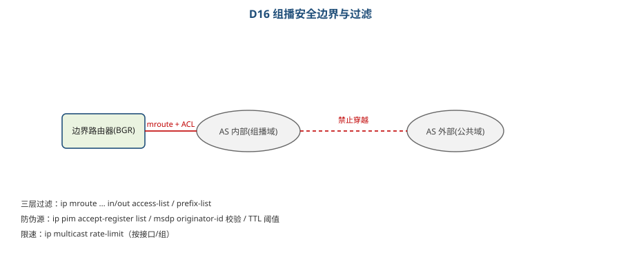

# 第 11 章 组播安全：把"信任假设"逐条拆掉

> 精读来源：**Aweya §6.6–6.8（p.380–385：default MSDP peer 与前缀过滤、mesh-group 免除 peer-RPF、SA 缓存与限速、对 DoS 的防护）、§6.14（p.413：SA 过滤）、Volume II（p.13–14：组播的安全边界与分区要求）**
> 本章解决的问题：单播安全模型假设"连接是双向的、可以握手鉴权"；组播**没有连接、没有握手、接收者匿名、源可伪造**。所以组播安全的本质是：**用"过滤 + 边界 + 限速"替代"认证"**。

## 学习目标

1. 列出组播的五个结构性弱点（无连接、匿名接收、源可伪造、控制面无认证、状态可被放大）；
2. 说清"组劫持"与"源伪造"的攻击面差异，以及 SSM 为什么能缓解后者；
3. 说清 MSDP mesh-group 的**安全副作用**：成员之间不做 peer-RPF；
4. 解释 Auto-RP / BSR 为什么"谁都能宣告自己是 RP"，以及怎么防；
5. 区分"防护"与"可用性"：ACL 误伤 IGMP/MLD 是同一类事故；
6. 给出一份可落地的四层过滤清单（接入 / 域内 / 域间 / 数据面）。

---

## 1. 五个结构性弱点

| 弱点 | 具体表现 | 与单播的差别 |
|---|---|---|
| 无连接 | UDP + 组播，无握手 | 单播可靠 TLS/握手，组播只能靠预共享密钥 |
| 接收者匿名 | 发者不知道谁在收 | 无法按"人"授权 |
| 源可伪造 | 任何人可发 `(S,G)` 声称自己是 S | 单播靠 RPF 无法防伪造（RPF 只查路径） |
| 控制面无认证 | IGMP/MLD、PIM、Auto-RP、BSR 均无内建认证 | 只能靠 ACL + 前缀过滤 |
| 状态可放大 | 一个伪造的 `(S,G)` 可在全网建状态 | 状态是共享资源，易被耗尽 |

> 关键认知：**RPF 不是安全机制**。RPF 校验"源是否从正确方向来"，但攻击者只要在正确方向上发包就通过。安全必须另外加。

---

## 2. 组劫持：最容易被忽视的攻击

### 2.1 机制

IGMP/MLD 的 Report/Done **没有任何认证**。任何主机都可以：

1. 发 Report 加入任意组 → 交换机/路由器为该组建立转发 → **流量被拖到自己身边**；
2. 发 Leave/Done → 把别人踢出组（造成拒绝服务）。

在二层，如果开了 snooping 但没有 **IGMP profile / 端口策略**，攻击者甚至可以让某个组被"永久加入"，形成持续占用带宽。

### 2.2 防护（按层）

| 层 | 手段 | 说明 |
|---|---|---|
| 接入端口 | IGMP/MLD profile、组地址白名单 | 只允许加入业务组 |
| 接入端口 | 每端口组数限制（`ip igmp limit`） | 防状态耗尽 |
| 二层 | IGMP snooping + querier + 组播 MAC 过滤 | 防泛洪与被劫持 |
| 网关 | 固定 DR Priority、关闭无关接口的 PIM | 减少状态面 |

---

## 3. 源伪造与 SSM

任何主机都能发送 `239.1.1.1` 的流量并自称源 `10.1.1.1`。由于 RPF 只校验路径，**接收端无法判断"这个源是不是真的"**。

两种缓解：

- **SSM**：接收者显式订阅 `(S,G)`，非请求源的流量在最后一跳被丢弃（不是加密，但有效）；
- **应用层签名/加密**：真正的来源认证只能在应用层做。

> 这就是第 6 章"SSM 六条规则"的安全价值：**规则 1/4 让非请求源的数据根本无法沿 `(*,G)` 注入**。

---

## 4. 控制面：谁都能当 RP

Auto-RP 与 BSR 都没有认证机制（Auto-RP 尤其：`224.0.1.39` 的 announce 谁都能发）。后果：

- 攻击者在任意位置发 C-RP Announce → **MA 可能接受并全网下发**；
- 若其 IP 更高，甚至可能赢过合法 RP（Aweya p.304 的"选最高 IP"规则）；
- 结果是全网组播被导向攻击者（黑洞或嗅探）。

防护只能靠"边界 + 过滤"：

| 机制 | 防护点 |
|---|---|
| Auto-RP | 只允许合法 RP 地址的 announce 进入（ACL 过滤 224.0.1.39/40 的源）；RP 地址用 prefix-list 白名单 |
| BSR | 过滤 BSM（224.0.1.40）的源；只信任核心区发来的 BSM |
| 静态 RP | 无协商 = 无劫持面，但运维成本高 |

---

## 5. MSDP：mesh-group 的信任放大

Aweya p.383 有一句非常关键的话（原文可核对）：

> 使用 MSDP mesh-group 意味着来自 mesh-group 成员的 SA 消息**总会被接受，不再需要 peer-RPF 检查**。

工程含义：**mesh-group 把"逐条校验"换成了"整组信任"**。一个成员被攻破或配置错误，它发出的任意 SA 会被全体成员无条件接受，进而让全域去建立到伪造源的树。

对应的防护（Aweya p.381、385、413 提供了机制）：

- **IP Prefix List**：default peer 只在指定前缀范围内被信任（p.381）；
- **SA 过滤规则**：对接收/转发的 SA 按 `(S,G)` 过滤（p.385、p.413）；
- **SA 缓存与限速**：p.383 —— 路由器**必须**缓存 SA；且通告节奏被限制在"不超过 SA-Adv 定时器的 2 倍、且每个周期至少一次"，用于**抑制 SA 转发风暴**；
- **对等体 DoS 防护**：p.384 提到可用 SA 过滤保护 peer 免受 DoS。

```bash
show ip msdp sa-cache summary          # 条目总数，异常增长即预警
show ip msdp peer                      # 收发计数
ip msdp sa-filter in <peer> ...        # 收方向过滤
ip msdp sa-filter out <peer> ...       # 发方向过滤
```

---

## 6. 边界：唯一真正有效的防线

Volume II p.13–14 的观点：**跨越国际互联网收发组播必须有安全边界**；应用与安全要求常常要求更紧的域边界（安全分区）。

可落地的四层清单：

| 层 | 必做项 |
|---|---|
| 接入 | 组地址白名单、每端口组数限制、snooping + querier |
| 域内 | 只允许核心设备发 PIM/BSR/Auto-RP；接入层关闭 PIM（除非是 DR） |
| 域间 | `multicast boundary`（按 239.x 范围）、只放行 ASM 或 SSM 之一、过滤 224.0.1.39/40 的源 |
| 数据面 | CoPP 限速 PIM/IGMP/ICMPv6、uRPF 谨慎使用、组播 ACL 落在入向 |



---

## 7. 八个工程案例

> 典型化场景，用于训练推理路径。

### 案例 1：某办公区加入一个"测试组"，全楼视频卡顿

- **现象**：某楼层带宽突增，`show ip mroute` 出现非业务组。
- **定位**：`show ip igmp groups`（哪些端口加入）、接入交换机端口统计。
- **根因**：主机随意加入高码率组，或恶意脚本批量加入（组劫持）。
- **处置**：接入端口加 IGMP profile 白名单与组数限制。
- **复盘**：**IGMP 无认证，接入侧必须假设"任何主机都可能乱发"**。

### 案例 2：接收端收到"冒充源"的行情数据

- **现象**：同一组内出现异常内容；源地址与合法源相同或相近。
- **定位**：抓包比对源 MAC/源 IP、`show ip mroute` 的入接口。
- **根因**：攻击者在另一位置伪造源地址发包，RPF 只校验路径不校验身份。
- **处置**：迁到 SSM（显式订阅源）+ 应用签名；接入侧禁止用户口发组播。
- **复盘**：**RPF 不等于认证**，这是组播安全的第一常识。

### 案例 3：接入层组播泛洪打满上行

- **现象**：交换机上行 1 Gbps 打满，未订阅的主机也收到流量。
- **定位**：`show ip igmp snooping`、端口广播/组播速率。
- **根因**：snooping 未开或 querier 缺失，组播按广播泛洪。
- **处置**：开启 snooping + querier，配置 storm control。
- **复盘**：**"组播省带宽"依赖最后一跳的 snooping**，否则等于广播。

### 案例 4：mesh-group 内一台 RP 被入侵，全域建立伪造树

- **现象**：多域突然出现大量 `(S,G)`，源地址陌生；`sa-cache` 条目暴涨。
- **定位**：`show ip msdp sa-cache` 的 originator、`show ip msdp peer` 的 mesh-group 成员。
- **根因**：mesh-group 成员间不做 peer-RPF，伪造 SA 被无条件接受（Aweya p.383）。
- **处置**：加 SA 过滤（前缀白名单）、隔离被入侵节点、必要时拆 mesh-group。
- **复盘**：**便利性与校验强度是反比**；mesh-group 越大，信任放大越严重。

### 案例 5：有人把自己宣告成 RP，全网被黑洞

- **现象**：全域组播突然中断，`show ip pim rp mapping` 显示陌生 RP。
- **定位**：RP 映射表的来源与地址、`show ip mroute 224.0.1.39/40` 的入接口。
- **根因**：Auto-RP announce 无认证，攻击者在接入层发送 announce，且 IP 更高获胜。
- **处置**：边界 ACL 只允许核心 RP 地址的 announce；接入层禁用 PIM。
- **复盘**：**Auto-RP/BSR 的"选举规则"会被攻击者利用**——IP 高者胜意味着可控性差。

### 案例 6：外部注入 BSM，跨域组播走错 RP

- **现象**：与某运营商互联后，部分组走错 RP；`show ip pim bsr-router` 指向外部设备。
- **定位**：`show ip pim bsr-router`、`show ip mroute 224.0.1.40`、边界 ACL。
- **根因**：BSM 未被边界过滤，外部 BSR 被接受。
- **处置**：边界阻断 224.0.1.40 与 224.0.0.13 的入向；组播边界只放行业务组。
- **复盘**：**组播控制面报文的"入向过滤"是最低成本的防线**。

### 案例 7：PIM 状态耗尽导致核心设备重启

- **现象**：核心 CPU/内存飙升，`show ip mroute summary` 条目数异常；随后 OSPF 邻居抖动。
- **定位**：`show ip mroute summary`、`show proc cpu sorted`、CoPP 计数。
- **根因**：大量伪造 `(S,G)`（或扫描器）触发状态建立，控制面被打满。
- **处置**：CoPP 限速 PIM/IGMP、关闭非必要接口 PIM、加 SA 过滤。
- **复盘**：**组播攻击的载体常常是"状态"，而不是带宽**。

### 案例 8：加固后业务中断——ACL 拦了 IGMP/MLD

- **现象**：安全加固上线后，部分楼宇组播不通；`show ip igmp groups` 为空。
- **定位**：接口 ACL 命中计数、抓包看 IGMP/ICMPv6（v6 场景）。
- **根因**：ACL 只放行 TCP/UDP，IGMP（协议号 2）与 ICMPv6 MLD 被丢。
- **处置**：显式放行 IGMP 与 MLD 类型；加固清单里加入"组播控制面协议"。
- **复盘**：**安全与可用性是同一枚硬币**——加固必须包含"业务所需的异常协议"。

---

## 8. 十问自测

1. 组播的五个结构性弱点？
2. 为什么说 RPF 不是安全机制？
3. 组劫持的最小攻击面是什么？
4. SSM 如何缓解源伪造？
5. mesh-group 为什么"免除 peer-RPF"？风险是什么？
6. SA 缓存的两个作用？
7. Auto-RP 无认证时，防护靠什么？
8. BSM 应该在哪一层过滤？
9. CoPP 保护的是哪类资源？
10. 加固方案要额外放行哪两个"非 TCP/UDP"协议？

---

## 9. 原文精读索引

> 纸面页码：Aweya = PDF 页 − 21；Volume II = PDF 页 − 18。

| 知识点 | 书/节 | 纸面页 | 原文可核对要点 |
|---|---|---|---|
| default MSDP peer 与前缀过滤 | Aweya §6.6 | p.381 | 多个 default peer 时只有主 peer 生效；配置 IP Prefix List 后可按前缀分别接受 |
| **mesh-group 免除 peer-RPF** | Aweya §6.6 | p.383 | “Source-Active messages will always be accepted from mesh-group peers without requiring peer-RPF checks” |
| SA 必须缓存与限速 | Aweya §6.7 | p.383 | RFC 3618 要求 MUST cache；通告周期 ≤ 2×SA-Adv 且每周期至少一次，抑制风暴 |
| SA 缓存的内存代价 | Aweya §6.7.1 | p.383 | 缓存条目越多占用内存越大 |
| 对 peer 的 DoS 防护 | Aweya §6.8 | p.384 | 可用过滤规则保护 peer 免受 DoS |
| SA 过滤规则配置 | Aweya §6.8.3 | p.385 | 可对发送/接收方向的 `(S,G)` 过滤 |
| 过滤 SA 的运维价值 | Aweya §6.14 | p.413 | 运营商可决定哪些源写入 SA |
| 组播的安全边界与分区 | v2 Ch1 | p.13–14 | 跨互联网收发组播需安全边界；应用/安全要求需要更紧的域边界 |

---

## 10. 延伸

- 标准：RFC 3618（MSDP，含 SA 过滤）、RFC 4607（SSM）、RFC 5796（PIM-SM 的 DoS 考量）
- 下一章：排障方法论——把前面 10 章串成一套四步法
- 回顾：第 2 章 IGMP、第 5 章 RP 发现（无认证的两个机制）、第 7 章 MSDP
