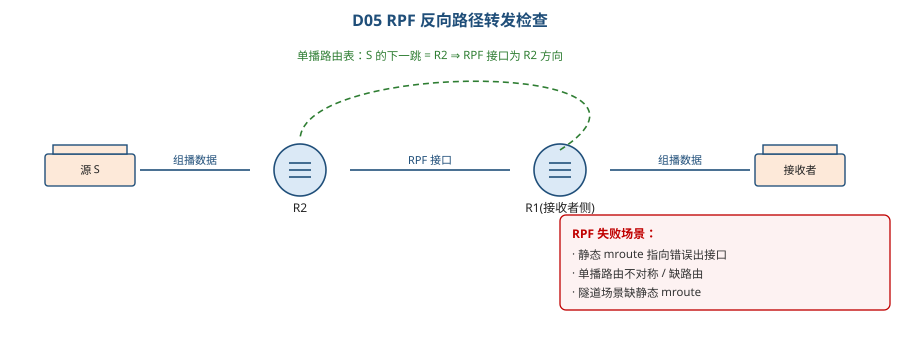

# 第 12 章 排障方法论：四步法与变更检查单

> 精读来源：**Aweya p.40–42（RPF 四级回退链）、p.272（三套下游状态）、§5.7（Register 状态）、p.381–385（SA 过滤与缓存）**、**Volume II p.9 / p.60（`show ip mroute` 标志位释义）、p.118（RPF 接口是 tunnel 场景的唯一考虑）**
> 本章解决的问题：前 11 章讲每块"应该怎么工作"，本章讲**出问题时按什么顺序看**——组播排障的最大浪费是"从 mroute 开始猜"，正确起点是**RP 映射表**。

## 学习目标

1. 记住四步法的顺序与每步的"否决条件"；
2. 把 `show ip mroute` 的 7 个标志位与具体故障一一对应；
3. 用"是否 `(S,G)` 存在"作为分叉点，把故障分成两大类；
4. 区分"真故障"与"设计如此"的 12 种现象；
5. 用变更检查单避免"改完一半"（这是组播事故的第一大来源）；
6. 知道每类故障在哪个设备上取证最省时间。

---

## 1. 四步法

```
① RP 映射表  →  ② (*,G)  →  ③ (S,G)  →  ④ 数据面
   show ip pim rp mapping   show ip mroute   show ip rpf   接口计数/抓包
```

每一步只回答一个问题，**不通过就停，不要跳步**。

| 步 | 命令 | 通过条件 | 不通过说明 |
|---|---|---|---|
| ① | `show ip pim rp mapping` | 该组有**唯一且正确**的 RP | 无 RP / 多 RP 冲突 / RP 不在本域 |
| ② | `show ip mroute <G>` | 有 `(*,G)`，Incoming interface 与 `show ip rpf <RP>` 一致 | 接收者未加入 / Join 未上行 / RPF 不通 |
| ③ | `show ip mroute <G>` | 有 `(S,G)`，flags 含 `J`（已切 SPT） | 源未注册 / RP 未拉源 / RPF 到源失败 |
| ④ | 接口计数、`tcpdump` | 出接口有流量、下游有包 | 二层 snooping / ACL / MTU / 双份 |



**为什么起点是 RP 表**：80% 的"部分组不通"来自 RP 映射错误或不一致（第 5 章案例 5、7）。从 mroute 开始看，你只能看到结果，看不到原因。

---

## 2. `show ip mroute` 标志位对照表

Volume II p.9 / p.60 给了完整释义，结合各章故障对照如下：

| 标志 | 含义 | 缺/异常时的典型故障 |
|---|---|---|
| `D` | Dense（PIM-DM） | 出现在本应 SM 的组 → 模式划错 |
| `S` | Sparse（PIM-SM） | — |
| `B` | Bidir Group | BIDIR 组没有 `(S,G)` 是正常的 |
| `R` | 该 `(S,G)` 由 Register 建立 | 长期存在 `R` 而无 `J` → 未切 SPT |
| `J` | 已加入 SPT | 缺失 → 最后一跳去源不可达 |
| `T` | 还要向 RP 发 `(S,G,rpt)` Prune | 缺失 → RPT 未剪，上游带宽浪费 |
| `x` | VxLAN group | 说明这是 DC 的 BUM 组，不是应用组 |
| `C` | 直连接收者 | 误判"有接收者" |

---

## 3. 分叉点：`(S,G)` 存在吗

| 现象 | 优先怀疑 | 首个命令 |
|---|---|---|
| 有 `(*,G)`、无 `(S,G)` | 源未注册（RPF/ACL）、RP 无 SA、BIDIR 组 | 源端 `show ip mroute`；RP 上 `show ip pim tunnel` |
| 有 `(S,G)`、无 `J` | 最后一跳切不了 SPT（去源路由不通） | `show ip rpf <S>` |
| 有 `(S,G)`、有 `J`、无流量 | 二层/ACL/MTU | 出接口计数、`tcpdump` |
| 全都没有 | 接收者未加入 / IGMP 被拦 | `show ip igmp groups` |

---

## 4. 十二个"不是故障"的现象

| # | 现象 | 真相 |
|---|---|---|
| 1 | RP 上 `(*,G)` 的 OIL 为空 | RP 是树根，先无接收者时正常 |
| 2 | BIDIR 组没有 `(S,G)` | 设计如此 |
| 3 | SSM 组没有 `(*,G)` | 六条规则禁止 |
| 4 | 切 SPT 后 RPT 利用率低 | 预期行为 |
| 5 | `show ip mroute` 里 `(S,G)` 的 "shared tree" 一栏有入接口 | `(S,G,rpt)` 状态仍在，正常 |
| 6 | 组播 ping 不通但业务正常 | 组播 echo 需要协议栈配合，不代表转发失败 |
| 7 | VXLAN BUM 组出现在 mroute | underlay 需要它 |
| 8 | 源在本机时 RPF 为 Null | 直连源，正常 |
| 9 | 双向树的 `(S,G)` 计数为 0 | BIDIR 不按 `(S,G)` 计数 |
| 10 | 组播流量只在第一次 ping 后出现 | 首包触发建树 |
| 11 | 多路径下 `(S,G)` 随机落在一条链路 | ECMP 哈希，需检查是否打散同一 `(S,G)` |
| 12 | 老设备发 `(*,G)` 到 SSM 组 | 规则 1/4 会拒绝，属预期 |

---

## 5. 八个跨层案例

> 典型化场景；本章案例强调"跨层假设"，不是具体故障取证。

### 案例 1：单播全通、组播全断

- **定位**：`show ip multicast-routing`（是否启用）、接口 `ip pim sparse-mode`。
- **根因**：只配了 RP，未全局启用组播路由。
- **复盘**：**组播是"全局开关 + 接口开关 + RP"三件套**，缺一不可。

### 案例 2：只有一部分组不通

- **定位**：`show ip pim rp mapping` 逐组比对；`show running-config | include rp-address`。
- **根因**：静态 RP 与 BSR 覆盖范围不同，或组范围 ACL 重叠。
- **复盘**：**"部分组"= 映射表不一致**，不是链路问题。

### 案例 3：只有一部分源不通

- **定位**：源所在网段的 RPF（`show ip rpf <S>`）、RP 上是否有该源的 SA/注册。
- **根因**：源网段汇总路由导致 RPF 指向错误上游。
- **复盘**：**按源分段排查**，别一次改全局配置。

### 案例 4：只有一部分接收者不通

- **定位**：最后一跳 `show ip igmp groups`、接入交换机 snooping 与 querier。
- **根因**：接入层 snooping 缺 querier，或端口 ACL 拦 IGMP。
- **复盘**：**"个别楼宇不通"先看二层**。

### 案例 5：能收但花屏/丢包

- **定位**：接口计数（input/output drops）、MTU、CoPP 计数。
- **根因**：CoPP 限速过低（PIM/IGMP 被限）、MTU 不匹配、链路误码。
- **复盘**：**控制面限速会表现为"周期性抖动"**（如每 210 s 一次），别当链路问题。

### 案例 6：切换后中断，回切恢复

- **定位**：`show ip rpf <S>` 在切换前后的差异、`show ip route` 收敛时间。
- **根因**：IGP 收敛慢 + 组播未做优雅重启/NSF，RPF 短暂失效。
- **复盘**：**组播对收敛时间比单播敏感**——单播重传可掩盖，组播直接表现为断流。

### 案例 7：跨域不通，域内正常

- **定位**：MSDP 邻居与 SA 缓存、MBGP 前缀、边界 ACL。
- **根因**：SA 未传播或 RPF 走默认路由。
- **复盘**：**域间问题先看"源发现"，再看"路径"**（第 7 章）。

### 案例 8：上云/进 DC 后不通

- **定位**：云侧 ACL/IGMP 支持、VXLAN 复制方式、underlay PIM。
- **根因**：云不提供原生组播；或 VXLAN 用组播复制但 underlay 无 PIM。
- **复盘**：**先确认环境是否"支持组播"，再排查配置**（第 9 章）。

---

## 6. 变更检查单

组播变更事故的共同模式是"**只改了一半**"——源侧改了、接收侧没改；RP 改了、静态兜底没删。

| 检查项 | 为什么 |
|---|---|
| RP 地址与组范围在**全网**一致 | 不一致 = 部分组不通 |
| 静态 RP 遗留是否清理 | 静态优先于动态，会"赢"掉新配置 |
| 新模式（SM/DM/BIDIR/SSM）范围是否互斥 | 同一组不能两种模式 |
| SSM 范围是否排除在 RP 范围外 | 否则 232/8 被当 ASM |
| 接口 PIM 是否在**所有**路径接口启用 | 少一个 = Join 断链 |
| 边界 ACL 是否放行 IGMP/MLD/PIM（协议 2 / ICMPv6 / 103） | 加固顺手掐死控制面 |
| 组播边界（multicast boundary）是否按组范围 | 防止跨域泄漏 |
| CoPP 限速是否覆盖 PIM/IGMP 突发 | 过低造成周期性抖动 |
| MSDP mesh-group 成员是否齐全 | 漏一台 = SA 打转 |
| 回滚步骤是否准备（RP/范围/ACL 三项） | 组播回滚比单播慢 |

---

## 7. 十问自测

1. 四步法的顺序与每步的否决条件？
2. 为什么从 RP 映射表开始而不是 mroute？
3. `R` 与 `J` 同时缺失说明什么？
4. `T` 缺失的后果是什么？
5. `x` 标志代表什么？为什么容易误判？
6. 有 `(S,G)` 无 `J` 时首查什么？
7. 为什么组播 ping 不通不代表业务不通？
8. 控制面 CoPP 过低的表现特征是什么？
9. 组播对 IGP 收敛为什么更敏感？
10. 变更检查单里最容易被漏掉的三项？

---

## 8. 原文精读索引

> 纸面页码：Aweya = PDF 页 − 21；Volume II = PDF 页 − 18。

| 知识点 | 书/节 | 纸面页 | 原文可核对要点 |
|---|---|---|---|
| **RPF 四级回退链** | Aweya §1.x | p.40–42 | 静态 mroute → MBGP → 单播 RIB → 默认路由；同前缀再比 metric |
| 三套下游状态机 | Aweya §5.8 | p.272 | `(*,G)`、`(S,G,rpt)`、`(S,G)` 分别维护 |
| Register 状态与抑制 | Aweya §5.7 | p.249–250 | 抑制 60 s、Probe 时间、RP 保留 3× |
| SA 过滤与缓存 | Aweya §6.8 / §6.14 | p.384–385、413 | 收发方向过滤；必须缓存；限速抑制风暴 |
| `show ip mroute` 标志释义 | v2 Ch1/Ch2 | p.9、p.60 | 含 `x - VxLAN group`、`B`、`J`、`T`、`R` 等 |
| tunnel 场景的唯一考虑 | v2 Ch2 | p.118 | 点对点 GRE 下“唯一的考虑是 RPF 接口” |

---

## 9. 延伸与收尾

- 练习：iPexpert 的《IPv4/6 Multicast Operation and Troubleshooting》实验册（本笔记未逐页引用，仅作为动手练习清单）
- 标准：RFC 7761（PIM-SM）、RFC 3973（PIM-DM）、RFC 5015（BIDIR）、RFC 4607（SSM）、RFC 3618（MSDP）
- 回到开头：[第 1 章](ch01-basics.html) 的模型 → 本章的四步法，是同一个知识体系的两种用法：**建模型，再拆模型**
